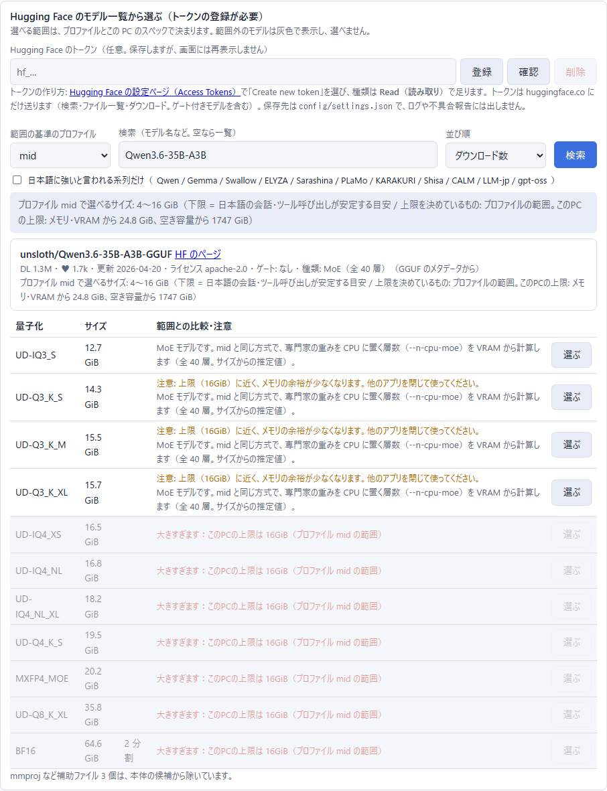

English | [日本語](README.md)

# koemado

A **one-click, local voice-chat avatar for Windows.**
You talk to it with a microphone (or type), a local LLM thinks up a reply, and Irodori-TTS reads it aloud.
Nothing is sent to the cloud, unless you choose an external inference server yourself.

```
Browser (mic) ─ AIAvatarKit ─ STT: faster-whisper (CPU)
                    │
                    ├─ LLM: llama.cpp llama-server (GGUF)   * can be replaced with an external inference server
                    └─ TTS: Irodori-TTS v4.1 Small (int8, CUDA)
```

> **A rule shared by every character.**
> No character responds to sexual content, or to sexual topics involving minors.
> The rule lives in `characters/_common.md` (the part shared by all characters), so a character's settings cannot remove it.
> A character's age is optional.
> However, Strata's "refusal suppression (ESP)" can be turned on only while the character in use has an age of 18 or older (it cannot be used when the age is under 18 or not set).
> The bundled sample character, Mio, has no age set, so ESP cannot be used with her.
> Her voice was made with Voice Design (not the voice of a real person).
> The sample character's images are fetched at setup time from the examples of AIAvatarKit (uezo/aiavatarkit, Apache License 2.0).
> They are not included in the koemado repository.

## Language note: the app is Japanese-first

- The app's UI (conversation screen, settings screen, admin console) and the character prompts are written in **Japanese**.
- **The TTS (Irodori) only speaks Japanese.**
  The LLM can understand and answer in English, but the voice can only read Japanese text, so English replies cannot be spoken properly.
- If you do not read Japanese, you can still set everything up with this document, `setup.bat`'s prompts (also Japanese, but short), and your browser's translation feature.
  The settings screen shows Japanese labels; this README gives the English meaning of the ones you need.
- The `config/`, `characters/` and `skills/` files are plain text, so you can edit them directly if you prefer.

## Requirements

| Item | Details |
|---|---|
| OS | Windows 10 / 11 (64-bit) |
| GPU | **An NVIDIA GPU is required** (RTX 20 series or newer, 6 GB VRAM or more). Driver **570 or newer** (needed by PyTorch CUDA 12.8) |
| RAM | 16 GB or more (32 GB or more for the standard profile) |
| Free disk space | About 19 to 35 GB depending on the profile (see the table below), on the drive you install to |
| Network | Setup downloads from GitHub / Hugging Face / PyPI (about 15 to 32 GB in total) |

On a PC without an NVIDIA GPU, TTS takes more than ten seconds per sentence and a conversation is not practical, so setup aborts.

## Installation

1. Download this repository (unzip it, or `git clone`). Put it on a **drive with plenty of free space** (the install location defaults to this folder).
2. Double-click `setup.bat`.
   - It inspects the PC (GPU, VRAM, RAM, free disk space, ports in use), picks a matching profile and shows the plan.
     Press **Enter** to start installing.
   - After the profile is chosen, you can **choose the LLM model** (see "Choosing the model" below). If you choose nothing, the profile's default model is installed.
   - If uv (a Python manager) is missing, it is installed into the repository's `tools\` folder.
     Nothing is installed system-wide.
   - If it stops halfway, run `setup.bat` again and it resumes (finished downloads are not fetched again).
3. When setup is done, double-click `start.bat` (or the desktop shortcut).
   **No black console window appears.**
   Your browser opens a "starting..." page (the admin console), the services start in the order LLM, TTS, STT, AIAvatarKit, and when everything is ready it switches to the conversation screen automatically.
4. To stop: tray icon of koemado, then Exit; the Exit button in the admin console; or `stop.bat`.

### Confirmation before installing

`setup.bat` prints the detection result and a table of what will be installed (download size and disk use per item, totals, free space on the target drive before and after, and estimated time at 100 Mbps / 1 Gbps).
It starts **only if you answer `y` or `yes` to the prompt `この内容でインストールしますか？ [y/N]:` ("Install with this plan?")**.
Anything else (an empty Enter, `n`, ...) exits without changing anything.
`--yes` skips the prompt but always prints the table.
When resuming, it shows the remaining amount, minus what is already downloaded.

### Using Strata (recommended for PCs with 12 GB+ VRAM and 48 GB+ RAM)

If the PC has **at least 12 GB VRAM and at least 48 GB RAM**, and the disk has room for Strata (about 80 GB), setup offers [Strata](https://github.com/Niko1221/Strata) (Qwen3.8-Flash-Next) regardless of the profile (high / mid / low).
Replies are much better than with the bundled LLM (Gemma 4 26B-A4B for mid).
With 12 to 19 GB of VRAM the expert cache is smaller and speed drops (measured in Strata's README: RTX 5070 12 GB with 64 GB RAM gives about 79 tokens/s with IQ2_XS and about 53 tokens/s with IQ3_S).

- Strata's requirements: NVIDIA (or an AMD GPU supported by Strata, but this project itself is NVIDIA-only), 12 GB+ VRAM, 48 GB+ RAM (with 32 GB RAM only the Coder edition fits, which is weak at Japanese chat, so it is not offered), about 80 GB of disk (about 70 GB download).
- Caveats: it is separate software (licensed by Strata). It handles one request at a time. It makes the PC sluggish for 1 to 3 minutes at startup.
- Choices: **[1]** install Strata and use it (fetched into `<install dir>\strata`, and Strata's installer opens in a separate window; model selection and download happen there) / **[2]** already installed (enter its URL) / **[3]** continue with the bundled LLM (shown with the selected profile name).
- `--yes` never installs the roughly 70 GB on its own (it continues with the selected bundled profile and only prints the guidance). `--llm strata` chooses [1], and `--llm external --llm-url http://127.0.0.1:8080/v1` chooses [2].
- After [1], `start.bat` starts Strata first and waits up to 10 minutes for `/v1/models` to respond (progress is shown in the admin console). The port is read from Strata's `strata-*.json`. `stop.bat` only stops the Strata that `start.bat` started.
- So that Strata does not fill the VRAM with its expert cache, `--vram-reserve-mib 3500` (headroom for TTS) is written **only into the Strata settings of this install**. LLM-to-TTS serialization is on, `reasoning_effort=none`, temperature 0.8.
- The Strata commit is pinned (`82f46a8`). Update Strata yourself with `strata\UPDATE.bat`.
- Strata's installer (START-HERE.bat) may install Python 3.12 into your user profile on PCs without Python (that is Strata's own behavior).

### Refusal suppression for Strata (ESP) and image recognition

Switch these in the LLM tab of the settings screen (when using Strata) or with `configure.bat`.

- **Refusal suppression (Strata's "experimental speed projection")**: off by default. **Despite its name it is not a speed-up.** It uses a control vector shipped with Strata to remove the "refusal direction", so **the model almost never declines a request (its safety behavior is removed)**. It costs only about 0.2 to 0.4 % per token. You are responsible for the output. The vector is specific to Qwen3.8-Flash-Next (it does not work with Swift 1.5 or the Coder edition) and is under the Qwen Community License 1.0. A confirmation dialog appears when you turn it on. ESP can be turned on only while the character in use has an age of 18 or older; otherwise the settings screen and configure.bat show the reason and keep it off. If ESP is on and you try to switch to a character under 18 or with no age set, you are asked whether to turn ESP off and switch, or to cancel the switch. The shared rule against sexual content applies whether or not ESP is on.
  - **Strata started by `start.bat` (`strata\`)**: when on, a `strata-<model>-esp.json` (same format as Strata's setup; the log is named `-esp.log`) is created and used. When off, the original config is used. Strata must be restarted after a change (the screen shows a restart button).
  - **A Strata you started yourself**: its launch arguments cannot be changed, so the app only sends `experimental_speed_projection` (`true` when on, `false` when off) with each request. It only has an effect on a Strata that was started with the vector loaded. Whether it is effective is not exposed in `/props`, so it cannot be detected.
- **Image recognition (vision)**: on the Strata path of `setup.bat` you can choose "GPU (recommended; 0.1 to 0.5 s per image, about 1.4 GB VRAM) / CPU (10 to 30 s per image) / off (default)" with `--vision gpu|cpu|no` (also passed to Strata's installer). With GPU, 4900 MiB (the 3500 MiB TTS headroom plus 1400 MiB for the encoder) is set as `--vram-reserve-mib`, because Strata's setup writes only 700 for both GPU and CPU and does not add the encoder's share automatically.
  - When image recognition is on in the settings screen, an "send an image" panel (file picker, paste, camera) appears on the conversation screen. Images stay on this PC and are **not saved in the conversation history (SQLite)** unless you turn that on in the settings screen.
  - With an external server, it works only if the server has image recognition enabled. The connection test sends a small image to check.
- Future work: the bundled LLMs (Gemma 4 / Qwen3.6) could also handle images with an mmproj, but that is out of scope for now.

### `setup.bat` options

```
setup.bat --dry-run                       inspect and print the plan only (installs nothing)
setup.bat --profile mid --yes             choose the profile and proceed without asking
setup.bat --install-dir D:\aiavatar       choose the install location (default: this folder)
setup.bat --llm external --llm-url http://127.0.0.1:1234/v1 --llm-model MODEL
                                          use an external inference server (no llama.cpp or model installed)
setup.bat --llm strata                    install and use Strata (for high-end PCs; about 70 GB)
setup.bat --model unsloth/Qwen3-8B-GGUF:Qwen3-8B-Q4_K_M.gguf
                                          choose the bundled LLM's model (repository:file; models outside the range are refused)
setup.bat --model <repo>:<file> --hf-token-env   use the HF_TOKEN environment variable (never put a token on the command line)
setup.bat --dry-run --simulate "vram=8,ram=32,disk=60"   judge as if on another PC (for testing)
```

If the environment variable `HF_TOKEN` is set, or a Hugging Face token is already saved in the settings, `setup.bat` uses it for the model download.

### Choosing the model (during setup)

After the profile is chosen, `setup.bat` asks how to choose the LLM model (with `--yes` it does not ask and uses the default).

- **[1] Recommended (default)**: the profile's default model.
- **[2] Pick from the Hugging Face list** (a token is required): the token is typed without echo (`getpass`). It is verified with `whoami-v2`; if valid, the user name is shown and you are asked whether to save it to `config/settings.json` (shared with the settings screen). If the `HF_TOKEN` environment variable exists, it asks whether to use it. Then you choose a search term, a candidate (sorted by downloads), a repository, and a GGUF file from a list showing sizes, whether each is within range, and the reason and cautions for those outside. Models outside the range cannot be chosen. For a gated model you have not accepted, the URL of the terms page is shown. An invalid token gives an error and lets you type it again.
- **[3] Type the repository and file name** (a token is optional): the size is fetched and checked against the range.
- The chosen model is reflected in the confirmation table (download size, disk use, time estimate).
- Non-interactively, use `--model <repo>:<file>`. If a token is needed, set the `HF_TOKEN` environment variable and add `--hf-token-env`. There is no option to pass a token directly on the command line (it would stay in history and process lists).
- After setup you can still change the model in the settings screen (LLM tab).

### Downloads use `hf download`

All model downloads from Hugging Face (GGUF, Irodori, Whisper and so on) use `hf download` (the `huggingface_hub` CLI, with `hf_xet`). It is installed with pinned versions into `tools\hf-venv` (`setup.bat` and the settings screen use the same `hf.exe`).

- The token is passed to the child process only through the `HF_TOKEN` environment variable, never as a command-line argument (arguments show up in process lists).
- A split GGUF (`-0000N-of-`) is fetched with a single `hf download` covering all parts. If interrupted, running it again resumes where it stopped. In the settings screen, Cancel stops the process.
- **Fallback when slow**: if the 60-second average speed falls below 1 MB/s, `hf download` is stopped and the download switches to 16 parallel Range requests (for environments where the Xet/CDN connection is throttled to a single stream). The switch is shown in the log and on the screen. The file is verified against the SHA256 from HF (the LFS oid). The token is attached only to huggingface.co. The thresholds can be changed with the environment variables `KOEMADO_HF_SLOW_BPS` (bytes per second) and `KOEMADO_HF_SLOW_WINDOW_SEC` (seconds), for testing.

## Profiles

The LLM runs on llama.cpp's `llama-server`. A profile is chosen automatically from the PC's specs (override with `--profile`).
If there is not enough free disk space, it drops one level.

| Profile | Requirement (VRAM / RAM) | LLM (GGUF) | Model size | Free space needed (approx.) |
|---|---|---|---|---|
| high | 20 GB+ / 48 GB+ | Qwen3.6-35B-A3B (UD-Q4_K_M) | 20.6 GiB | about 35 GB |
| mid (standard) | 8 GB+ / 32 GB+ | Gemma 4 26B-A4B (QAT UD-Q4_K_XL) | 13.3 GiB | about 27 GB |
| low | 6 GB+ / 16 GB+ | Gemma 4 E4B (QAT q4_0) | 4.8 GiB | about 19 GB |

- **mid** keeps most of the MoE experts' weights on the CPU side so that VRAM holds about 3.6 GB for the LLM plus about 2.7 GB (peak) for TTS (on an 8 GB GPU, leaving room for the Windows desktop).
- Disk breakdown: llama.cpp about 1.2 GB, the TTS runtime (PyTorch CUDA) about 5.2 GB, TTS and STT models about 2 GB, other environments about 1 GB (the download cache is removed at the end of setup).
- To swap a model, edit the table in `profiles.py`. If you register a Hugging Face token, you can also pick any GGUF from a list in the settings screen, within the range of your profile (see "Model browser" below).

### Pinned versions

llama.cpp `b11443` (CUDA 12 build) / Irodori-TTS-Server `61012c7` (follows `uv.lock`) / Irodori-TTS v4.1 Small int8 (`Aratako/Irodori-TTS-v4.1-Small-Quantized`) / aiavatar 0.9.1 / fastmcp 4.0.11 / ddgs 9.16.0 / faster-whisper 1.2.1 (small, CPU int8) / pystray 0.19.5 / pillow 12.3.0. Dependency versions are pinned in `app/requirements.txt` and `stt/requirements.txt`.

## Starting and the admin console

`start.bat` launches a resident management process (`supervisor.py`) with no window and closes immediately.
The supervisor starts and watches the LLM (llama-server, or Strata), TTS, STT and AIAvatarKit **without any console windows**, so that non-technical users are not startled by lots of black windows.

- **Admin console**: `http://127.0.0.1:8099/` (if the port is taken, a free one is chosen and saved to `config.json`; it opens even if AIAvatarKit is down; only reachable from 127.0.0.1, with Host / Origin checks).
  - "State": running status, port and uptime per service, VRAM and RAM, restart per service, restart all and quit. While starting it shows progress and moves to the conversation screen automatically when ready (including the long first load of Strata). If startup fails, a button opens the log of the failed service.
  - "Logs": a tab per service plus "All". Auto-updating (SSE), INFO / WARNING / ERROR coloring and filtering, text search, pause auto-scroll, copy, download.
  - **"Download a bundle for bug reports"**: puts all recent logs and environment info (GPU, driver, memory, profile, versions) into one zip. **Ask friends to send this zip when reporting problems.**
  
  
- Logs are also saved to `logs\<service>.log` (rotated at 5 MB, 4 generations). **Anything that looks like an API key or token (the keys you entered in the settings screen, `Bearer` values, `api_key=` and so on, and strings starting with `hf_`) is masked** before being saved, shown or downloaded.
- **A service that exits abnormally is restarted automatically** (up to 3 times in 5 minutes). After that it is left stopped and the console shows a message to check the log.
- Child processes are tied to the supervisor with a Job Object. Even if the supervisor is killed, the OS stops every service (no orphans). It never starts twice (running `start.bat` while it is running just opens the page).
- A **tray icon** appears (menu: open conversation / settings / logs and state / restart / quit). If the tray is unavailable, the app keeps running (use the console's Quit button or `stop.bat`).
- The conversation and settings screens have a link to the admin console at the top right.
- At the end of `setup.bat` it asks whether to create "koemado" shortcuts on the desktop and start menu (they start without a window). You can create them later with `app\.venv\Scripts\python.exe ctl.py shortcuts`.

## Usage

- Conversation screen: `http://127.0.0.1:8100/static/index.html` (the "starting..." page moves there automatically). Microphone permission is required.
  - The screen is in Japanese (setup rewrites the fetched AIAvatarKit page). The "割り込み" (barge-in) toggle lets you speak and stop the avatar while it is talking; with speakers it can pick up the avatar's own voice and stop, so headphones are recommended. When it is off (the default), the microphone is not accepted until the avatar has finished speaking.
- **Settings screen: `http://127.0.0.1:8100/settings`** (voice, LLM, character, tools; `configure.bat` changes the same settings interactively).
- Admin screen (metrics, logs): `http://127.0.0.1:8100/admin`
- Try it without a browser: `app\.venv\Scripts\python.exe tools\e2e_test.py "こんにちは" --repeat 3` (sends text over WebSocket and prints the reply, expression tags, audio and timing; the sample text means "hello").

All servers listen on `127.0.0.1` only. The settings screen and `/ws` cannot be used from other PCs or other websites (Host / Origin are checked as well).

### What the settings screen can do


**Voice**: list and preview the reference voices (`tts/voices/`) and switch (**applied from the next utterance, no restart**). Upload a reference voice (wav / flac / mp3 / ogg / opus; m4a / aac / webm cannot be read in this environment). Voice Design (make candidates from a caption plus a seed, preview them and save the one you like). num_steps (speed versus quality).
The upload screen shows a notice that you must not use the voice of a real person without their consent, and asks you to confirm.


**LLM**:
- **Bundled llama-server**: choose a profile (high / mid / low), or **any GGUF** (a Hugging Face repository plus file name, or the path of a local .gguf). The size of the chosen model is compared with this PC's specs (VRAM / RAM / free disk) and "too heavy" or "not enough disk" warnings are shown. Downloads ask for confirmation and show a progress bar. Temperature, thinking on/off and context length can also be set.
- **External inference server** (OpenAI-compatible): Strata / LM Studio / Ollama / vLLM / llama-server on another PC / a cloud API. Set base_url, API key (optional), model name (choose from `/v1/models`), how to stop thinking (`reasoning_effort` / `chat_template_kwargs` / send nothing), whether to use tool calling, and whether to serialize LLM and TTS. The **connection test** button checks response time, thinking leaking into the answer, and tool calling.
  - Serialization: when the LLM and TTS share one GPU, turn it **on** (prevents fighting over VRAM and compute, and makes the first audio faster). For another PC or the cloud, off is a good default.
  - External servers are not started by `start.bat`. If you start one first, `start.bat` waits up to 2 minutes for `/v1/models` to respond before starting AIAvatarKit.
  - Presets: Strata (`:8080/v1`; handles one request at a time; needs 12 GB+ VRAM and 48 GB+ RAM; see "Using Strata" above, and the next section for refusal suppression and image recognition), LM Studio (`:1234`), Ollama (`:11434/v1`), vLLM, another PC, cloud. The ports are each tool's defaults and can be changed.
  - API keys are stored in `config/settings.json` (git-ignored). They are never shown again on the screen (masked) and never written to logs.
  - If you choose a cloud API (or another network), the screen warns that **your conversation is sent outside**.
- After changing the LLM mode, model, endpoint or context length, press `保存して再起動` ("Save and restart") on the screen, or run `start.bat` again. Temperature and thinking take effect from the next message.

#### Model browser (register a Hugging Face token and pick any LLM)

If you register a Hugging Face (HF) token, you can pick an LLM from the list of GGUF models on HF, **within the range that suits your profile**.
The token is optional. Without it, you can still use the models in the profile table and enter any GGUF by hand (repository plus file name).

- **Token**: register, verify and delete it in the LLM tab (and in `configure.bat`, under the Hugging Face token item). To create one, open the [HF settings page](https://huggingface.co/settings/tokens), choose "Create new token", and a **Read** token is enough.
  - It is stored in `config/settings.json` (git-ignored). The screen shows it masked and never displays it again after saving.
  - The verify button calls only `https://huggingface.co/api/whoami-v2` and shows the user name and whether the token is valid (an invalid token is reported as invalid).
  - **The token is sent to huggingface.co only.** When a download is redirected to a CDN, the token is removed before following the redirect.
  - It is used for search, the file list and downloads (including gated models). `setup.bat` also uses the `HF_TOKEN` environment variable or the saved token.
  - The value never appears in the admin console logs, the bug-report zip or the settings API responses (strings starting with `hf_` are masked too).
  - While no token is registered, list selection is disabled and the screen says "Register a token to choose from the list" (the Japanese message reads: `トークンを登録すると一覧から選べます`).
- **Search**: a search term, sort order (downloads, likes, last updated), "only model families said to be strong at Japanese" (Qwen, Gemma, Swallow, ELYZA and so on; the list is `JA_FAMILIES` in `profiles.py`), and paging.
- **File list**: choosing a repository shows each quantization and its size. A split GGUF (`-00001-of-0000N`) is shown as one model with the total size, and auxiliary files such as mmproj are excluded from the candidates. Each repository and candidate shows download count, likes, last update, license and whether it is gated.
  - If the model is gated and you have not accepted its terms, the screen shows a link and tells you to accept the terms on the HF page (the same message appears when a download gets a 403).
- **Range (lower and upper limit)**: each profile has a range of file sizes you can choose (`MODEL_LIMITS` in `profiles.py`). Files outside the range are shown in gray with the reason and cannot be selected.
  - The range is displayed together with the current profile. If you change the profile, the range changes too.
  - Even inside the range, cautions are shown. A dense (non-MoE) model that greatly exceeds the VRAM left after the TTS headroom will run slowly because much of it lands on the CPU. For MoE models, the screen says whether `--n-cpu-moe` can be computed the same way as for mid.
  - Whether a model is dense or MoE, and its layer count, are read from the GGUF metadata (the first bytes of the file). If that fails, they are guessed from the name (for example `35B-A3B`).
- **Download and switching**: it shows the size and free disk space and asks for confirmation, then downloads (progress, resume from where it stopped, cancel). When finished it restarts llama-server with that model and automatically runs the connection test (short reply, no thinking leaking, tool calling). If the test fails, a "go back to the previous model" button appears.
  - llama-server arguments are decided the same way as for the existing profiles. For a MoE model whose layer count is known, when the installed profile is mid, the number of layers whose experts stay on the CPU (`--n-cpu-moe`) is computed from VRAM. Otherwise `--fit` decides. `--jinja` is always added. The context length is 8192 (4096 for large models close to this PC's limit).
  - There is also a list of downloaded models with deletion (to recover disk space). They are stored in `models\<owner>--<name>\` (keeping the path inside the repository). Downloads work as described in "Downloads use `hf download`" above.

| Profile | Selectable size range | Caution threshold | Basis of the range |
|---|---|---|---|
| high | 8 to 28 GiB | 25 GiB and up | Up to about 1.35 times the default (20.6 GiB), which is what fits in 24 GB VRAM plus 48 GB RAM. The lower bound is about a 12B model at Q4 |
| mid | 4 to 16 GiB | 14 GiB and up | Up to about 1.2 times the default (13.3 GiB), roughly half of 32 GB RAM. The lower bound is about a 7B model at Q4 |
| low | 2 to 6 GiB | 5.4 GiB and up | Up to about 1.25 times the default (4.8 GiB), which is what is left of 16 GB RAM after the OS, TTS and STT. The lower bound is about a 3B model at Q4 |

Models smaller than the lower bound are not selectable, because Japanese conversation and tool calling tend to become unstable.

On top of that range there is an absolute upper limit from the detected hardware: the smaller of **(RAM minus 4 GiB for the OS, 1.5 GiB for STT, 1.5 GiB for the app and 3 GiB for TTS) plus (VRAM minus 2.7 GiB for TTS and 1.5 GiB for the desktop) minus 1 GiB for the KV cache and compute buffers**, and the free disk space (keeping 1 GiB spare).
For example, on a PC with 8 GB VRAM and 32 GB RAM the hardware limit is about 24.8 GiB (the mid range of 16 GiB is smaller, so it applies for mid).




**Character**: one character is one folder (`characters/<id>/character.yaml` and `image.png`). You can set name, age (optional), first-person pronoun, how to address the user, speech style, personality, likes and dislikes, background, relationship, example lines and the voice to use, and switch between several characters.
- The system prompt is built from `character.yaml` (rules for speech, expression and motion tags, weather and memory are shared in `characters/_common.md`). Long texts such as the background are the same string throughout a conversation, so the LLM's prompt cache works.
- Standing picture: upload a PNG from the settings screen and it is shown on the conversation screen. If expression-specific images such as `image_joy.png` exist (neutral / joy / angry / sorrow / fun / surprised / eyes_closed), they switch with the expression. Without an image a silhouette is shown. The images of the sample character Mio are fetched from AIAvatarKit's official samples at setup time and placed in `characters/mio/` (if the download fails, setup continues and she stays a silhouette; running setup.bat again retries).
- Memory (`app/data/memory_<id>.db`) is separate for each character.
- **Age is optional**: it may be left empty. ESP can be used only with characters whose age is set to 18 or older. Every character declines sexual content and sexual topics involving minors (a shared rule that character settings cannot change).

Settings are stored in `config/settings.json` (voice, LLM) and `characters/` (characters). `.env` (`app/.env`) holds only low-level values such as ports and is rebuilt by `start.bat`.

## Expression and lip-sync assets

The avatar on the conversation screen moves according to the files in `characters/<id>/`.
Everything is optional, and anything missing falls back to a simpler motion.
You can also upload them from the Character tab of the settings screen (mouth shapes come with a preview, deletion and a canvas-size warning).

### File names

```
characters/<id>/
  image.png            the base face picture (standing picture)
  image_neutral.png    per-expression face pictures (neutral / joy / angry / sorrow / fun / surprised); a missing expression stays on image.png
  image_eyes_closed.png  a face with closed eyes; used for blinking when present
  mouth/closed.png     mouth shapes: transparent PNGs with the same canvas size as the face picture, drawing only the mouth
  mouth/half.png
  mouth/open.png
  mouth/e.png
  mouth/u.png
```

- Recommended: square transparent PNGs of 512 to 1024 px (the conversation screen shows them inside a round frame). The limit is 10 MB and 4096 px per file.
- **Mouth shapes must have the same canvas size as the face picture.** They are simply stacked on top of the face, so no alignment settings are needed. The settings screen warns you if the sizes differ.
- The five shapes are `closed` (closed mouth), `half` (half open), `open` (a, o), `e` (i, e; wide), and `u` (u; pursed). You do not need all of them. A missing shape is replaced by a close one (`e` and `u` use `half`, `half` uses `open`). If there is no `closed`, nothing is drawn for a closed mouth.
- Expressions switch with tags such as `[face:joy]` at the start of a reply. Blinking happens only when `eyes_closed` exists.

### How it moves

| Assets | Motion on the conversation screen |
|---|---|
| With mouth shapes | The mouth image switches in time with the audio (an MFCC lip-sync that estimates vowels; when it cannot, the volume picks closed / half / open). Expression changes and blinking work too |
| A single image, or expressions only (no mouth shapes) | A light animation that follows the volume: a small bob and slight scaling while speaking, and a slow breathing motion while idle. When the expression changes, the picture fades briefly |
| No image (silhouette) | The same light animation as for a single image |

- The amount of motion can be set in "Avatar motion" on the settings screen: none / subtle (default) / large.
- When the browser's "reduce motion" setting (prefers-reduced-motion) is on, the motion stops (mouth images keep switching).

### How to make mouth shapes

1. Starting from the face picture (`image.png`), prepare five versions in which only the mouth is redrawn.
2. Export each with the **same canvas size as the face picture and everything except the mouth transparent** (in a paint program, hide the face layer and export only the mouth layer).
3. Put them in `mouth/` as `closed.png`, `half.png`, `open.png`, `e.png` and `u.png`, or upload them in the settings screen.

Tips for making them with image generation (inpainting):

- Use the face picture as the source and mask only the area around the mouth. Nothing outside the mask changes, so position and art style stay consistent.
- Use the same seed and the same prompt for all five shapes, changing only the mouth description, to keep the outlines close.
- Cut out only the generated mouth (using the difference from the source, or by hand), place it on a transparent background and export.

### Please note

- If you use pictures drawn by someone else, check the creator's terms of use (secondary use, modification, streaming).
- The sample character Mio's images are fetched from AIAvatarKit's official samples at setup time (see the credit above). AIAvatarKit's mouth shapes are already transparent 512x512 PNGs on the same canvas as the faces, so they only need renaming into koemado's format (`mouth/e.png` and so on). There is no closed-mouth image; "no overlay" (the mouth drawn on the face) is the closed state.
- For testing there is a script, `tools/make_test_avatar.py`, that makes a plain geometric face and mouth shapes (not a sample artwork).

## Troubleshooting

| Symptom | What to do |
|---|---|
| Stops with "the driver is too old" | Update to the latest NVIDIA driver (570 or newer). The script does not update drivers |
| Installation takes a long time | The first run downloads 15 to 32 GB in total and unpacks PyTorch (CUDA). On an HDD, or with real-time antivirus scanning, unpacking can take tens of minutes (a few minutes on an SSD). You can stop and rerun to resume |
| "Not enough free space" | Pass `--install-dir` with a drive that has room, or free up space. If space is short it drops one profile automatically |
| It does not react when I speak in the browser | Check the browser's microphone permission (the lock icon left of the address bar). `http://127.0.0.1` is treated as allowed for the microphone. You also need to allow the browser under Windows "Privacy, then Microphone" |
| Out of VRAM (`CUDA out of memory`, or the LLM or TTS does not start) | Close other apps (games, 3D software, browser hardware acceleration). In the LLM tab choose a lighter profile (low), or increase `--n-cpu-moe` (`profiles.py`) to use less VRAM |
| Replies are slow | The bundled LLM processes whatever does not fit in VRAM on the CPU. Use low, or an external inference server. TTS gets faster with a smaller num_steps |
| Port already in use | `setup.bat` and `start.bat` switch to a free port automatically (defaults: LLM 8081 / TTS 8088 / STT 8002 / app 8100; 8000 and 8080 are avoided) |
| Startup fails | Open the admin console (`http://127.0.0.1:8099/`, or the tray's "logs and state") and look at the logs. The files are `logs\llm.log`, `tts.log`, `stt.log`, `app.log` and `supervisor.log`. When reporting, send the zip from "Download a bundle for bug reports" (keys are masked) |
| The admin console does not open, or the supervisor is not running | Run `start.bat --console` (or `debug-start.bat`) to start every service in a **console window** as before (errors are visible directly). There is no admin console or tray in this mode. Stop with `stop.bat` |
| No tray icon | The app is running. Look inside the hidden indicators ("^") on the Windows taskbar. You can also stop it with the console's Quit button or `stop.bat` |
| Thinking leaks into replies | Change "how to stop thinking" in the settings screen (depending on the model, either `reasoning_effort` or `chat_template_kwargs` works) |

## Tools (web search, MCP, skills, external agent)

Configure them in the "Tools" tab of the settings screen (and in `configure.bat`). 

**Tool definitions are fixed at startup** (changing them mid-conversation would break the LLM's prompt cache). Changes take effect after "Save and restart". If you turn off "use tool calling" for an external server in the LLM tab, none of these tools can be used.

### Web search (on by default)

- `web_search(query)`: top 5 titles, URLs and summaries from DuckDuckGo (`ddgs`, no API key). **Search terms are sent to an external service (DuckDuckGo).**
- `web_fetch(url)`: reads a page's body as text. Only http / https. Destinations on this PC or an internal network, such as 127.0.0.1, 10.x, 192.168.x, link-local addresses and `file://`, are rejected, including redirect targets. The body is limited to 1 MB and 15 seconds (name resolution is checked before and after connecting, but protection against DNS rebinding is not perfect).
- Results are summarized briefly in spoken language, and URLs are not read aloud. It is used only when up-to-date information is needed.
- Weather (Open-Meteo) and memory can also be turned off individually in this tab.

### MCP

- `config/mcp.json` (same format as Claude Desktop, so you can paste it as is). See `docs/mcp.example.json` for an example.

  ```json
  {"mcpServers": {
    "demo": {"command": "python", "args": ["tools/mcp_test_server.py"], "allowed_tools": ["roll_dice", "current_time"]},
    "remote": {"url": "http://127.0.0.1:8765/mcp", "headers": {}, "enabled": false}
  }}
  ```

  You can add `enabled` (default true) and `allowed_tools` (all tools allowed if omitted). For stdio use command plus args (`python` is replaced by this app's Python; relative paths are relative to the install dir); for HTTP use a streamable-http URL.
- It connects at startup and registers the tools with the LLM. **A server that fails to connect is skipped** (a warning in `logs\app.log` and a "connection failed" mark in the settings screen) and the app still starts. A server's standard error goes to `logs\mcp_<name>.log`.
- Settings screen: server list (state and tool count), JSON editor, connection test (lists the tools so you can allow them individually), add and delete. env / headers values are shown masked.
- **Caution**: MCP tools are programs running on this PC, and some can operate on files or run commands. **A mis-heard voice command can be executed as is**, so add only servers you trust and narrow down the tools you allow. With many tools a small LLM becomes unreliable at calling them (rule of thumb, including the standard tools: 8 in total for low, 15 for mid, about 30 even for large models).
- `npx` servers need Node.js (it is not installed automatically; the connection test says so if it is missing).
- To try it, use `tools/mcp_test_server.py` (dice, time, addition). For HTTP: `app\.venv\Scripts\python.exe tools\mcp_test_server.py --http 8765`.

### Skills

- `skills/<name>/SKILL.md` (a `name` and `description` in the frontmatter and the steps in the body; a format similar to Claude's Agent Skills). Two are bundled: "news-topics" (today's news topics) and "research" (looking things up).
- Only the **list (name and description)** goes into the system prompt; the LLM reads the body with `use_skill(name)` when it needs it (keeping the prompt short and the cache intact). They are loaded at startup and shared by all characters.
- In the settings screen you can list, turn on or off, create, edit and delete skills.

### External agent (off by default)

Hand only long jobs (file operations, code execution, long research) to a separate worker agent. Weather and simple searches are handled by the avatar's own tools. The conversation continues after the request, and when the job completes the avatar speaks the result (`ask_agent` and, for progress, `check_agent_tasks`; AIAvatarKit's `OpenClawTool` and `use_invoke_queue`; active only while the integration is on).

- Kinds: Hermes Agent / OpenClaw. base_url (up to `/v1`; default `http://127.0.0.1:8642/v1`), API key (stored only in `config/settings.json` and never shown again), timeout (default 600 s). The "connection test" checks `/health` and `/v1/models`.
- **Caution**: Hermes's API grants access to all tools, including terminal execution. **Use it only inside 127.0.0.1 and always set an API key.** Do not loosen Hermes's approval settings.
- Installing Hermes itself is out of scope for this repository. Official install page: <https://hermes-agent.nousresearch.com/docs/>

## Ethical restrictions of Irodori-TTS (summary)

Irodori-TTS (MIT license) has the following usage restrictions in addition to the license. Please follow them in this project too.

1. **No impersonation**: do not clone or imitate the voice of a real individual, such as a voice actor, celebrity or public figure, without their explicit consent.
2. **No disinformation**: do not create synthetic speech (deepfakes) meant to deceive others or spread false information.
3. A voice made from a caption alone (without a reference voice) may happen to resemble a real person. This is a probabilistic effect and there is no intent to reproduce any specific person.
4. The developers take no responsibility for misuse. Using the output in compliance with the laws of your region is the user's responsibility.

The bundled voices (`voices/mio_a` to `mio_d`) were made with Voice Design using adult-female captions and fixed seeds, and are not the voice of any real person (captions, seeds and stability are in `voices/voices_meta.json`). Irodori embeds a watermark (SilentCipher) in the audio it generates.

## Licenses of the software this depends on

| Software | Purpose | License |
|---|---|---|
| This repository | | MIT |
| [llama.cpp](https://github.com/ggml-org/llama.cpp) | LLM inference | MIT |
| [AIAvatarKit](https://github.com/uezo/aiavatarkit) | Voice conversation base, browser UI | Apache-2.0 |
| [Irodori-TTS](https://github.com/Aratako/Irodori-TTS) / [Irodori-TTS-Server](https://github.com/Aratako/Irodori-TTS-Server) | Speech synthesis | MIT |
| [Irodori-TTS-v4.1-Small (quantized)](https://huggingface.co/Aratako/Irodori-TTS-v4.1-Small-Quantized) | TTS model | MIT (with ethical restrictions) |
| [Semantic-DACVAE-Japanese-32dim](https://huggingface.co/Aratako/Semantic-DACVAE-Japanese-32dim) / [DACVAE](https://github.com/facebookresearch/dacvae) | TTS codec | MIT / Apache-2.0 |
| [SilentCipher](https://github.com/sony/silentcipher) | Watermark for generated audio | MIT |
| [faster-whisper](https://github.com/SYSTRAN/faster-whisper) (Whisper small) | STT | MIT |
| [silero-vad](https://github.com/snakers4/silero-vad) | Voice activity detection | MIT |
| [PyTorch](https://pytorch.org/) | Running the TTS | BSD-3-Clause |
| [Qwen3.6-35B-A3B](https://huggingface.co/Qwen/Qwen3.6-35B-A3B) (GGUF: unsloth) | LLM (high) | Apache-2.0 |
| [Gemma 4](https://ai.google.dev/gemma/docs/gemma_4_license) (26B-A4B / E4B) | LLM (mid / low) | The Gemma 4 license (Hugging Face shows Apache-2.0; read the original text before use) |
| [Strata](https://github.com/Niko1221/Strata) (optional) | LLM for high-end PCs | MIT (each model has its own license; follow Strata's guidance) |
| [uv](https://github.com/astral-sh/uv) / [MinGit](https://github.com/git-for-windows/git) | Setup tools | MIT, Apache-2.0 / GPL-2.0 (installed only when needed) |

The browser UI shows the standing picture of the character chosen in the settings screen (or a silhouette if there is none). The sample character's images are fetched at setup time from the examples of AIAvatarKit (uezo/aiavatarkit, Apache License 2.0); they are not included in the koemado repository.

## File layout

```
setup.bat / setup.py   install (detect specs, choose profile, install automatically)
start.bat / stop.bat   start and stop (start.bat launches the supervisor without a window through koemado.vbs; --console / debug-start.bat give the classic console start)
supervisor.py          resident management process (starts and watches services, auto-restart, logs, admin console, tray)
console_ui/            the admin console (state and logs) pages
koemado.vbs / .ico     windowless launch (shortcuts use it too), icon
configure.bat / .py    interactive CLI for settings (a fallback for the settings screen)
ctl.py                 shared code for start, stop, restart, download and shortcuts (the console start lives here too)
profiles.py            LLM profile table, the size range for choosable models, llama-server arguments
hf_dl.py               Hugging Face downloads (running hf download, progress, cancel; the parallel Range fallback with SHA256 verification)
model_picker.py        model selection (grouping GGUFs, comparing with the range; shared by the settings screen and setup.bat's interactive mode)
hf_hub.py              Hugging Face API (search, file list, GGUF metadata, token check); sends the token only to huggingface.co
settings_store.py      reading and writing settings and characters, and the ESP age check
tools_store.py         MCP config (config/mcp.json) and skills (skills/) reading and writing
skills/                skills (news-topics and research are bundled)
app/                   AIAvatarKit itself (run.py), settings screen (settings_api.py / settings_ui), weather, memory, web search, MCP, skills, external agent
stt/                   faster-whisper STT server
voices/                bundled reference voices (adult female voices made with Voice Design)
characters/            characters (_common.md = shared rules, mio/ = sample)
tools/                 e2e_test.py (WebSocket test), make_voices.py (make voices with Voice Design), mcp_test_server.py (for checking MCP)
```

Things created by installation (not in Git): `strata/` and `strata-data/` (when you choose Strata), `config.json`, `config/`, `llama.cpp/`, `models/`, `tts/`, `hf-home/`, `torch-home/`, `app/.venv`, `stt/.venv`, `app/html/`, `app/data/`, `logs/` and so on.
