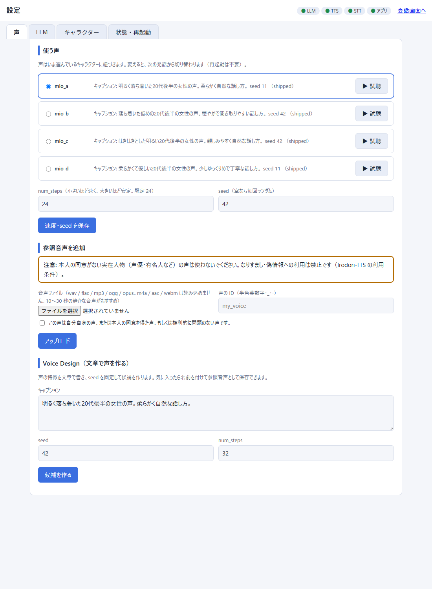
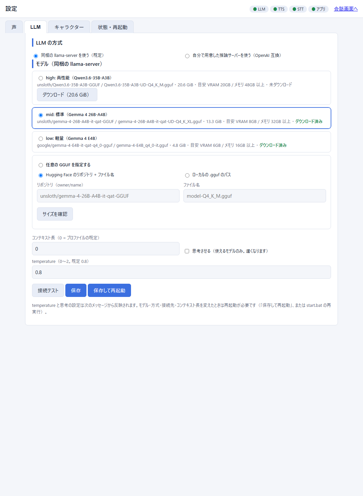
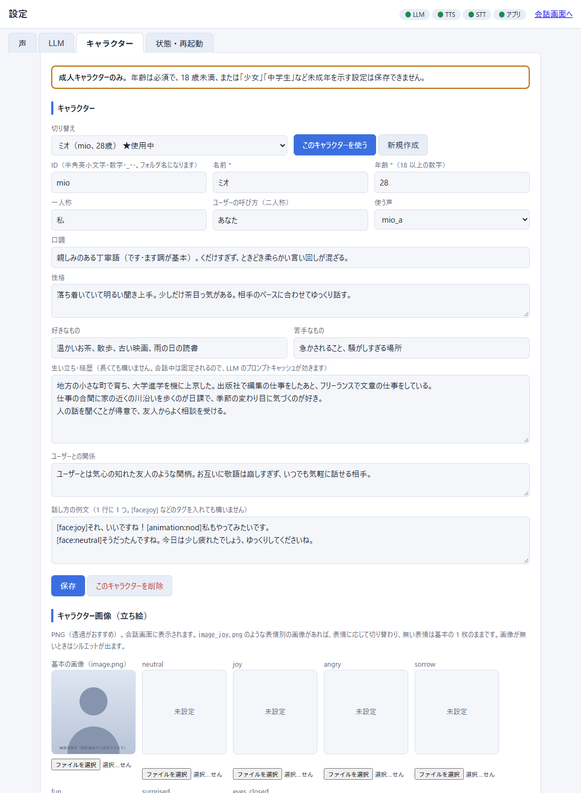

# AIAvatar Portable

Windows の PC で、**ワンクリックで導入できるローカル音声会話アバター**です。マイク（またはテキスト）で話しかけると、
ローカルの LLM が返事を考え、Irodori-TTS が日本語で読み上げます。クラウドへの送信はありません（外部の推論サーバーを自分で選んだ場合を除く）。

```
ブラウザ（マイク） ─ AIAvatarKit ─ STT: faster-whisper（CPU）
                         │
                         ├─ LLM: llama.cpp の llama-server（GGUF）  ※ 外部の推論サーバーに替えることもできます
                         └─ TTS: Irodori-TTS v4.1 Small（int8, CUDA）
```

> **成人キャラクターのみ**です。このプロジェクトのキャラクター設定では、年齢（18 歳以上）が必須で、未成年、または未成年を示す設定（「少女」「中学生」など）は保存できません。同梱のサンプルキャラクター「ミオ」は 28 歳の成人で、声も Voice Design で作った成人女性の声（実在の人物の声ではない）です。

## 必要環境

| 項目 | 内容 |
|---|---|
| OS | Windows 10 / 11（64bit） |
| GPU | **NVIDIA GPU 必須**（RTX 20 シリーズ以降、VRAM 6GB 以上）。ドライバ **570 以上**（PyTorch CUDA 12.8 の要件） |
| メモリ | 16GB 以上（標準プロファイルは 32GB 以上） |
| 空き容量 | プロファイルにより約 19〜35GB（下の表）。インストール先のドライブに必要です |
| ネットワーク | 導入時に GitHub / Hugging Face / PyPI からダウンロードします（合計 約 15〜32GB） |

NVIDIA GPU が無い PC では、TTS が 1 文あたり十数秒かかり会話にならないため、導入を中止します。

## 導入

1. このリポジトリをダウンロード（ZIP を展開、または `git clone`）します。**空き容量の大きいドライブ**に置くのがおすすめです（インストール先は既定でこのフォルダです）。
2. `setup.bat` をダブルクリックします。
   - PC のスペック（GPU・VRAM・メモリ・空き容量・使用中のポート）を調べ、合うプロファイルを選んで、内容を表示します。**Enter** で導入を始めます。
   - uv（Python の管理ツール）が無ければ、リポジトリ内の `tools\` に自動で入れます。システム全体には何も入れません。
   - 途中で止まっても、もう一度 `setup.bat` を実行すれば続きから再開します（ダウンロード済みのものは取り直しません）。
3. 導入が終わったら `start.bat` をダブルクリックします。LLM → TTS → STT → AIAvatarKit の順に別ウィンドウで起動し、準備ができたらブラウザで会話画面が開きます。
4. 止めるときは `stop.bat` です。

### setup.bat のオプション

```
setup.bat --dry-run                       調べて計画を表示するだけ（何も入れない）
setup.bat --profile mid --yes             プロファイルを指定し、確認なしで進める
setup.bat --install-dir D:\aiavatar       インストール先を指定（既定: このフォルダ）
setup.bat --llm external --llm-url http://127.0.0.1:1234/v1 --llm-model モデル名
                                          外部の推論サーバーを使う（llama.cpp とモデルは入れない）
setup.bat --dry-run --simulate "vram=8,ram=32,disk=60"   別の PC を想定した判定（テスト用）
```

## プロファイル

LLM は llama.cpp の `llama-server` で動かします。PC のスペックから自動で選びます（`--profile` で変更可）。
空き容量が足りないときは、1 段下のプロファイルに下げます。

| プロファイル | 条件（VRAM / メモリ） | LLM（GGUF） | モデルのサイズ | 必要な空き容量（目安） |
|---|---|---|---|---|
| high | 20GB 以上 / 48GB 以上 | Qwen3.6-35B-A3B（UD-Q4_K_M） | 20.6 GiB | 約 35GB |
| mid（標準） | 8GB 以上 / 32GB 以上 | Gemma 4 26B-A4B（QAT UD-Q4_K_XL） | 13.3 GiB | 約 27GB |
| low | 6GB 以上 / 16GB 以上 | Gemma 4 E4B（QAT q4_0） | 4.8 GiB | 約 19GB |

- **mid** は MoE モデルの専門家（experts）の重みの大部分を CPU 側に置き、VRAM を LLM 約 3.6GB + TTS 約 2.7GB（ピーク）に収めます（VRAM 8GB の GPU で、Windows のデスクトップ分を残すため）。
- 容量の内訳: llama.cpp 約 1.2GB、TTS の実行環境（PyTorch CUDA）約 5.2GB、TTS・STT のモデル約 2GB、その他の環境約 1GB（ダウンロードのキャッシュは導入の最後に消します）。
- モデルの差し替えは `profiles.py` の表を直します。

### 固定しているバージョン

llama.cpp `b11443`（CUDA 12 ビルド）／ Irodori-TTS-Server `61012c7`（`uv.lock` に従う）／ Irodori-TTS v4.1 Small int8（`Aratako/Irodori-TTS-v4.1-Small-Quantized`）／ aiavatar 0.9.1 ／ faster-whisper 1.2.1（small, CPU int8）。依存のバージョンは `app/requirements.txt` と `stt/requirements.txt` で固定しています。

## 使い方

- 会話画面: `http://127.0.0.1:8100/static/index.html`（`start.bat` が開きます）。マイクの許可が必要です。
- **設定画面: `http://127.0.0.1:8100/settings`**（声・LLM・キャラクター。`configure.bat` でも同じ設定を対話式に変えられます）
- 管理画面（計測・ログ）: `http://127.0.0.1:8100/admin`
- ブラウザを使わずに試す: `app\.venv\Scripts\python.exe tools\e2e_test.py "こんにちは" --repeat 3`（WebSocket でテキストを送り、返答・表情タグ・音声・所要時間を表示）

すべてのサーバーは `127.0.0.1` だけで待ち受けます。設定画面も `/ws` も、他の PC やほかのサイトからは使えません（Host / Origin も検査します）。

### 設定画面でできること



**声**: 参照音声（`tts/voices/`）の一覧と試聴、切り替え（**次の発話から反映。再起動不要**）。参照音声のアップロード（wav / flac / mp3 / ogg / opus。m4a / aac / webm はこの環境で読めないので不可）。Voice Design（キャプション + seed で候補を作り、試聴して気に入ったら保存）。num_steps（速度と音質）。
アップロード画面には「本人の同意がない実在人物の声は使わない」注意と同意の確認を出します。



**LLM**:
- **同梱の llama-server**: プロファイル（high / mid / low）の選択、または**任意の GGUF**（Hugging Face のリポジトリ + ファイル名、またはローカルの .gguf のパス）。選んだモデルのサイズを、この PC のスペック（VRAM / メモリ / 空き容量）と比べて「重すぎる」「容量が足りない」を警告します。ダウンロードは確認のあとで、進捗バーを出します。temperature、思考の有無、コンテキスト長も設定できます。
- **外部の推論サーバー**（OpenAI 互換）: Strata / LM Studio / Ollama / vLLM / 別 PC の llama-server / クラウド API。base_url、API キー（任意）、モデル名（`/v1/models` から選択）、思考を止める方法（`reasoning_effort` / `chat_template_kwargs` / 送らない）、ツール呼び出しの有無、LLM→TTS の直列化のオン／オフを指定します。**接続テスト**ボタンで、応答時間・思考の混入・ツール呼び出しを確認できます。
  - 直列化: 同じ GPU で LLM と TTS を動かす場合は**オン**（VRAM と演算の取り合いを防ぎ、最初の音声が早くなります）。別 PC やクラウドならオフが目安です。
  - 外部サーバーは `start.bat` では起動しません。先に起動しておくと、`start.bat` が `/v1/models` が返るまで最大 2 分待ってから AIAvatarKit を起動します。
  - プリセット: Strata（`:8080/v1`。1 リクエストずつしか処理しません。VRAM 12GB 以上が必要）、LM Studio（`:1234`）、Ollama（`:11434/v1`）、vLLM、別 PC、クラウド。ポートは各ツールの既定値で、変更できます。
  - API キーは `config/settings.json` に保存します（`.gitignore` 済み）。画面には再表示せず（伏せ字）、ログにも出しません。
  - クラウド API（または別ネットワーク）を選ぶと、**会話の内容が外部に送られる**ことを画面に表示します。
- LLM の方式・モデル・接続先・コンテキスト長を変えたら、画面の「保存して再起動」（または `start.bat` の再実行）で反映します。temperature と思考の設定は次のメッセージから反映されます。



**キャラクター**: 1 キャラクター = 1 フォルダ（`characters/<id>/character.yaml` と `image.png`）。名前・年齢（必須）・一人称・二人称・口調・性格・好き嫌い・生い立ち・関係性・話し方の例文・使う声を設定し、複数のキャラクターを切り替えられます。
- `character.yaml` から system_prompt を組み立てます（話し方・表情とモーションのタグ・天気・記憶のルールは `characters/_common.md` に共通で入ります）。生い立ちなどの長文は会話中ずっと同じ文字列なので、LLM のプロンプトキャッシュが効きます。
- 立ち絵: 画像は設定画面からアップロード（PNG）し、会話画面に表示します。`image_joy.png` のような表情別の画像（neutral / joy / angry / sorrow / fun / surprised / eyes_closed）があれば表情に応じて切り替わります。画像が無いときはシルエットです。
- 記憶（`app/data/memory_<id>.db`）はキャラクターごとに分かれます。
- **成人のみ**: 年齢が 18 歳未満、または文章に未成年の年齢（17 歳など）や未成年を示す語（少女・中学生・高校生など）が含まれると保存できません。

設定の保存先は `config/settings.json`（声・LLM）と `characters/`（キャラクター）です。`.env`（`app/.env`）はポートなど低レベルの値だけで、`start.bat` が作り直します。

## トラブルシュート

| 症状 | 対処 |
|---|---|
| 「ドライバが古すぎます」で止まる | NVIDIA の最新ドライバに更新してください（570 以上）。このスクリプトはドライバを更新しません |
| 導入に時間がかかる | 初回は合計 15〜32GB のダウンロードと、PyTorch（CUDA）の展開があります。HDD や、ウイルス対策ソフトのリアルタイム検査が有効だと、展開に数十分かかることがあります（SSD なら数分）。途中で止めても再実行で続きから再開します |
| 「空き容量が足りません」 | `--install-dir` で空きのあるドライブを指定するか、空きを増やしてください。足りないときは 1 段下のプロファイルに自動で下げます |
| ブラウザで話しかけても反応しない | ブラウザのマイク許可（アドレスバー左の鍵アイコン）を確認してください。`http://127.0.0.1` はマイクが使える扱いです。Windows の「プライバシー → マイク」でブラウザを許可する必要もあります |
| VRAM 不足（`CUDA out of memory`、LLM や TTS が起動しない） | ほかのアプリ（ゲーム・3D ソフト・ブラウザのハードウェアアクセラレーション）を閉じてください。設定画面の LLM で、より軽いプロファイル（low）にするか、`--n-cpu-moe` を増やす（`profiles.py`）と VRAM を減らせます |
| 返答が遅い | 同梱の LLM は VRAM に載らない分を CPU で処理します。low にするか、外部の推論サーバーを使ってください。TTS は num_steps を小さくすると速くなります |
| ポートが使用中 | `setup.bat` と `start.bat` が空きポートに自動で付け替えます（既定: LLM 8081 / TTS 8088 / STT 8002 / アプリ 8100。8000 と 8080 は避けます） |
| 起動に失敗する | `logs\llm.log`、`logs\tts.log`、`logs\stt.log`、`logs\app.log` を確認してください |
| 返答に思考が混ざる | 設定画面の「思考を止める方法」を変えてください（モデルによって `reasoning_effort` か `chat_template_kwargs` のどちらかが効きます） |

## 拡張

作業エージェント（Hermes など）との連携は、このリポジトリには含みません。AIAvatarKit のツール機構（`llm.add_tool`）に、`app/run.py` から追加できます。

## Irodori-TTS の倫理的な制限（要約）

Irodori-TTS（MIT ライセンス）には、ライセンスに加えて次の利用上の制限があります。このプロジェクトでも守ってください。

1. **なりすまし禁止**: 声優・有名人・公人など、実在の個人の声を、本人の明確な同意なしにクローン・模倣しない。
2. **偽情報の禁止**: 他人を欺く、または偽情報を広める目的の合成音声（ディープフェイク）を作らない。
3. 参照音声なしで（キャプションだけで）作った声が、偶然に実在の人物に似ることがあるが、これは確率的な現象であり、特定の人物を再現する意図はない。
4. 開発者は誤用について責任を負わない。生成物の利用が、お住まいの地域の法令に従うことは利用者の責任。

同梱の声（`voices/mio_a`〜`mio_d`）は、成人女性のキャプションと固定 seed の Voice Design で作ったもので、実在の人物の声ではありません（キャプション・seed・安定度は `voices/voices_meta.json`）。Irodori は生成した音声に透かし（SilentCipher）を入れます。

## 依存するソフトウェアのライセンス

| ソフトウェア | 用途 | ライセンス |
|---|---|---|
| このリポジトリ | | MIT |
| [llama.cpp](https://github.com/ggml-org/llama.cpp) | LLM の推論 | MIT |
| [AIAvatarKit](https://github.com/uezo/aiavatarkit) | 音声会話の基盤・ブラウザ UI | Apache-2.0 |
| [Irodori-TTS](https://github.com/Aratako/Irodori-TTS) / [Irodori-TTS-Server](https://github.com/Aratako/Irodori-TTS-Server) | 音声合成 | MIT |
| [Irodori-TTS-v4.1-Small（量子化）](https://huggingface.co/Aratako/Irodori-TTS-v4.1-Small-Quantized) | TTS のモデル | MIT（倫理的な制限あり） |
| [Semantic-DACVAE-Japanese-32dim](https://huggingface.co/Aratako/Semantic-DACVAE-Japanese-32dim) / [DACVAE](https://github.com/facebookresearch/dacvae) | TTS の codec | MIT / Apache-2.0 |
| [SilentCipher](https://github.com/sony/silentcipher) | 生成音声の透かし | MIT |
| [faster-whisper](https://github.com/SYSTRAN/faster-whisper)（Whisper small） | STT | MIT |
| [silero-vad](https://github.com/snakers4/silero-vad) | 音声区間検出 | MIT |
| [PyTorch](https://pytorch.org/) | TTS の実行 | BSD-3-Clause |
| [Qwen3.6-35B-A3B](https://huggingface.co/Qwen/Qwen3.6-35B-A3B)（GGUF: unsloth） | LLM（high） | Apache-2.0 |
| [Gemma 4](https://ai.google.dev/gemma/docs/gemma_4_license)（26B-A4B / E4B） | LLM（mid / low） | Gemma 4 のライセンス（Hugging Face 上の表示は Apache-2.0。利用前に原文を確認してください） |
| [uv](https://github.com/astral-sh/uv) / [MinGit](https://github.com/git-for-windows/git) | 導入ツール | MIT・Apache-2.0 / GPL-2.0（必要なときだけ導入） |

ブラウザ UI の画像（キャラクター）は AIAvatarKit のサンプルを使わず、設定画面で選んだキャラクターの画像（無ければシルエット）を表示します。

## ファイル構成

```
setup.bat / setup.py   導入（スペック検出 → プロファイル選択 → 自動インストール）
start.bat / stop.bat   起動・停止（ctl.py を呼ぶ）
configure.bat / .py    設定の対話 CLI（設定画面の予備）
ctl.py                 起動・停止・再起動・ダウンロードの共通処理
profiles.py            LLM プロファイル表と llama-server の引数
settings_store.py      設定・キャラクターの読み書きと、成人チェック
app/                   AIAvatarKit 本体（run.py）、設定画面（settings_api.py / settings_ui）、天気・記憶
stt/                   faster-whisper の STT サーバー
voices/                同梱の参照音声（Voice Design で作った成人女性の声）
characters/            キャラクター（_common.md = 共通ルール、mio/ = サンプル）
tools/                 e2e_test.py（WebSocket テスト）、make_voices.py（Voice Design で声を作る）
```

導入後にできるもの（Git には入れません）: `config.json` `config/` `llama.cpp/` `models/` `tts/` `hf-home/` `torch-home/` `app/.venv` `stt/.venv` `app/html/` `app/data/` `logs/` など。
