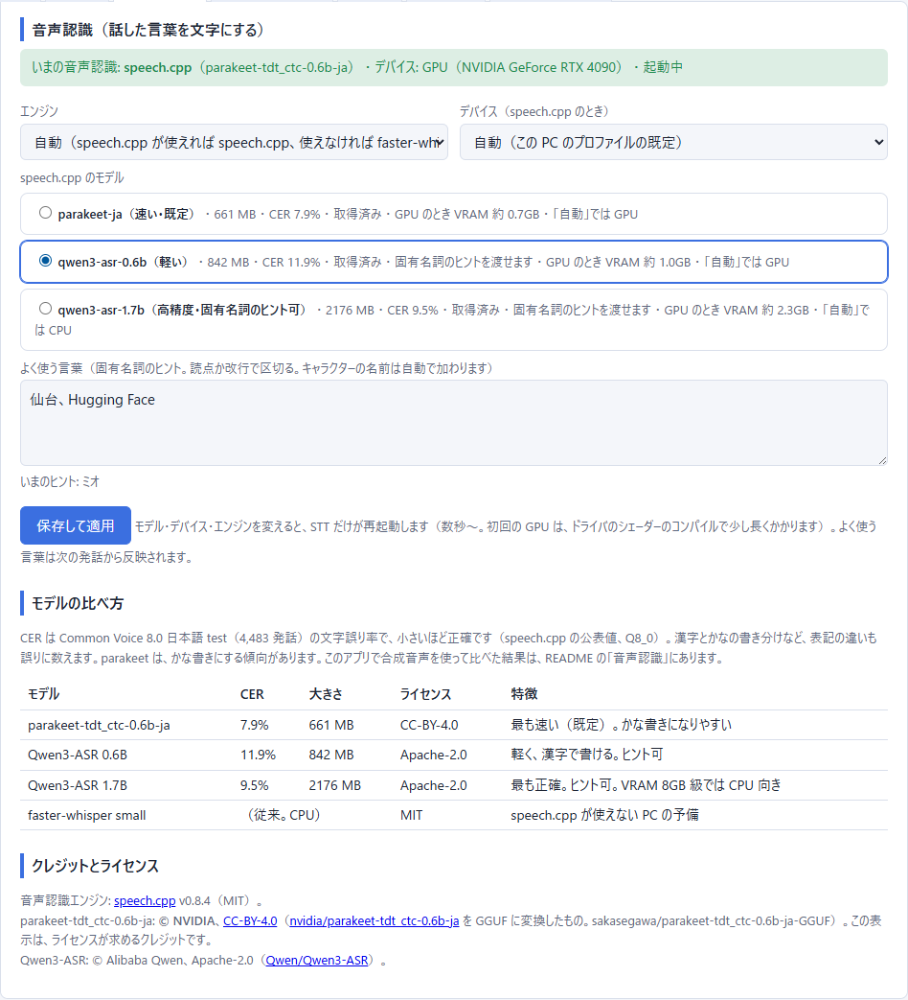
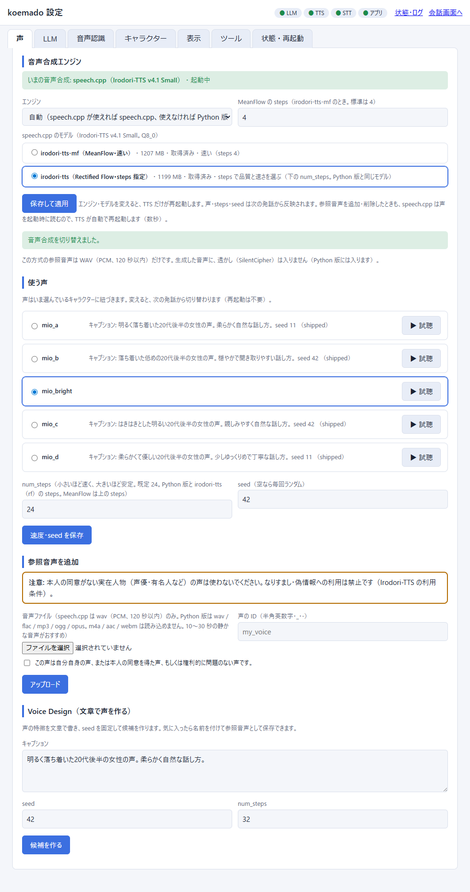
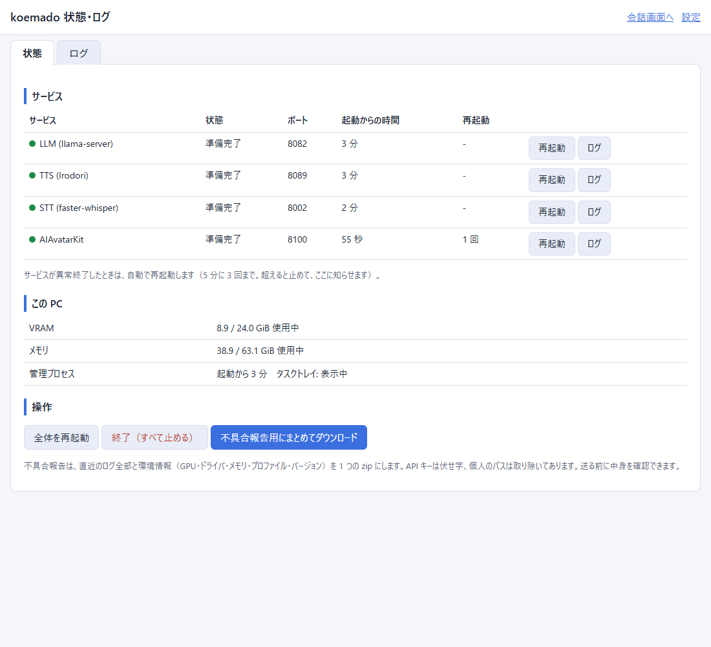
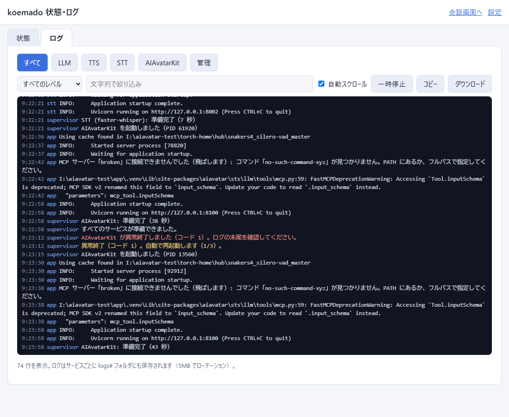
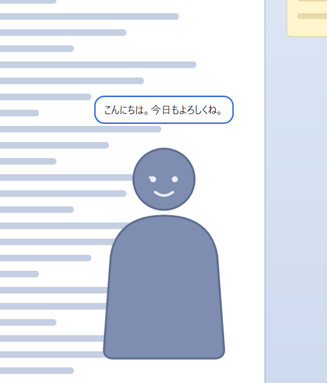
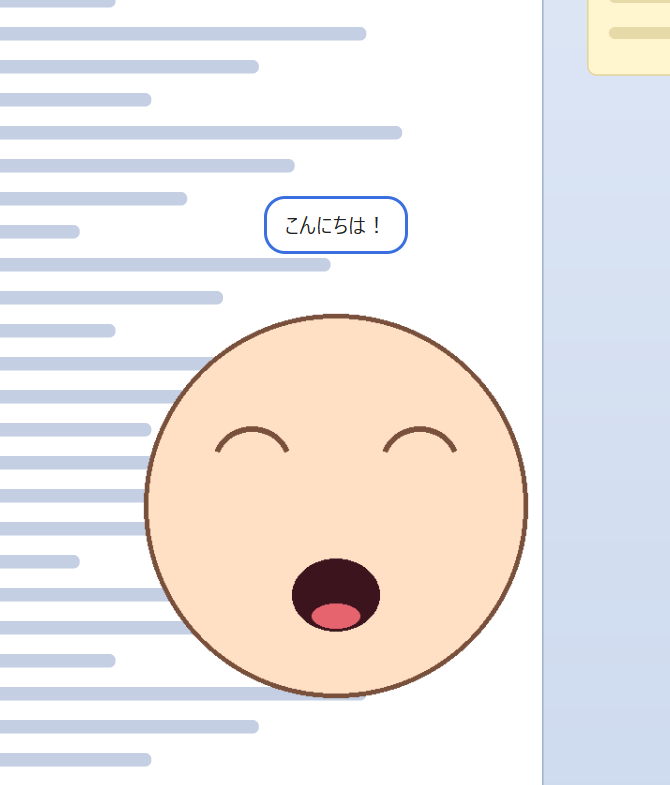
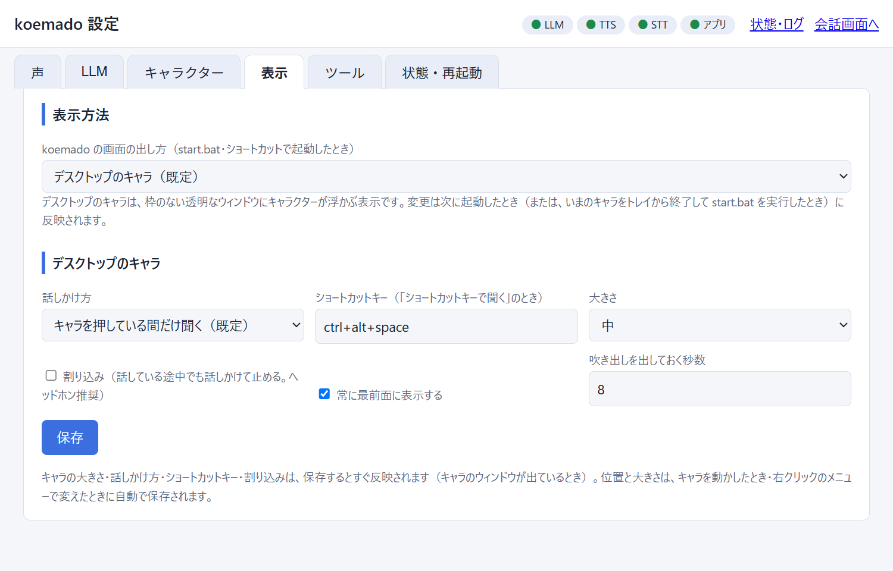
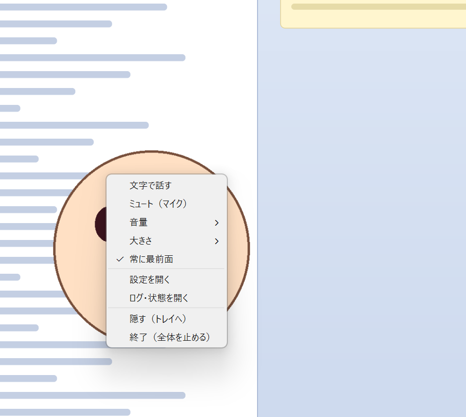
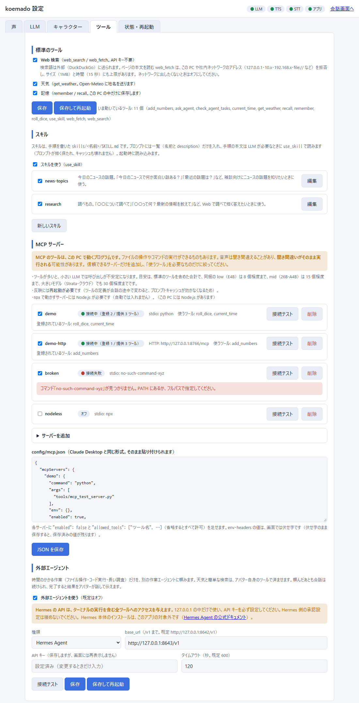

[English](README.en.md) | 日本語

# koemado（声の窓）

Windows の PC で、**ワンクリックで導入できるローカル音声会話アバター**です。\
マイク（またはテキスト）で話しかけると、
ローカルの LLM が返事を考え、Irodori-TTS が日本語で読み上げます。\
クラウドへの送信はありません（外部の推論サーバーを自分で選んだ場合を除く）。

```
ブラウザ / デスクトップのキャラ（マイク） ─ AIAvatarKit ─ STT: speech.cpp（Vulkan。GPU か CPU）
                         │
                         ├─ LLM: llama.cpp の llama-server（GGUF）  ※ 外部の推論サーバーに替えることもできます
                         └─ TTS: Irodori-TTS v4.1 Small（Python 版、int8、CUDA。speech.cpp 版も選べる）
```

> **すべてのキャラクターに共通する決まり**\
> 性的な内容や、未成年が関わる性的な話題には応じません。\
> この決まりは `characters/_common.md`（全キャラクター共通の部分）にあり、キャラクターの設定では消せません。\
> 年齢の設定は任意です。\
> ただし、Strata の「拒否の抑制（ESP）」は、使用中のキャラクターの年齢が 18 歳以上と設定されているときだけオンにできます（18 歳未満、または年齢が未設定のときは使えません）。\
> 同梱のサンプルキャラクター「ミオ」は年齢を設定していないので、ESP は使えません。\
> 声は Voice Design で作った声（実在の人物の声ではない）です。\
> サンプルキャラクターの画像は AIAvatarKit（uezo/aiavatarkit、Apache License 2.0）の examples から、導入時に取得します。\
> koemado のリポジトリには含まれません。

## 必要環境

| 項目 | 内容 |
|---|---|
| OS | Windows 10 / 11（64bit） |
| GPU | **NVIDIA GPU 必須**（RTX 20 シリーズ以降、VRAM 6GB 以上）。<br><br><br><br>ドライバ **570 以上**（PyTorch CUDA 12.8 の要件） |
| メモリ | 16GB 以上（標準プロファイルは 32GB 以上） |
| Vulkan | GPU のドライバに含まれる `vulkan-1.dll`（STT の speech.cpp 用。TTS を speech.cpp 版にするときも）。<br><br><br><br>無い PC では、STT は faster-whisper（CPU）で動きます（TTS の既定の Python 版は Vulkan を使いません）。 |
| 空き容量 | プロファイルにより約 20〜36GB（下の表。TTS を speech.cpp 版にすると約 6GB 減ります）。<br><br><br><br>インストール先のドライブに必要です |
| ネットワーク | 導入時に GitHub / Hugging Face / PyPI からダウンロードします（合計 約 11〜27GB） |

NVIDIA GPU が無い PC では、TTS が 1 文あたり十数秒かかり会話にならないため、導入を中止します。

## 導入

1. このリポジトリをダウンロード（ZIP を展開、または `git clone`）します。\
   **空き容量の大きいドライブ**に置くのがおすすめです（インストール先は既定でこのフォルダです）。
2. `setup.bat` をダブルクリックします。
   - PC のスペック（GPU・VRAM・メモリ・空き容量・使用中のポート）を調べ、合うプロファイルを選んで、内容を表示します。\
     **Enter** で導入を始めます。
   - プロファイルが決まったあと、**LLM のモデルを選べます**（下の「モデルの選び方」）。\
     何も選ばなければ、プロファイルの既定のモデルを入れます。
   - uv（Python の管理ツール）が無ければ、リポジトリ内の `tools\` に自動で入れます。\
     システム全体には何も入れません。
   - 途中で止まっても、もう一度 `setup.bat` を実行すれば続きから再開します（ダウンロード済みのものは取り直しません）。
3. 導入が終わったら `start.bat`（またはデスクトップのショートカット）をダブルクリックします。\
   **黒い画面は出ません。**\
   既定では、デスクトップにキャラクターが現れて、「起動中…」の吹き出しで進み具合を知らせます（「デスクトップのキャラ」の節）。\
   LLM → TTS → STT → AIAvatarKit の順に起動して、全部の準備ができたら、キャラが話せるようになります。\
   表示方法を「ブラウザ」にしているときは、従来どおり、ブラウザに「起動中…」の画面（管理画面）が開き、準備ができたら自動で会話画面に切り替わります。
4. 止めるときは、キャラの右クリックメニューの「終了」、タスクトレイの koemado アイコン →「終了」、管理画面の「終了」ボタン、または `stop.bat` です。

### 導入前の確認

`setup.bat` は、検出結果と導入内容の表（項目ごとのダウンロード量・ディスク使用量、合計、インストール先の空き容量と導入後の残り、100Mbps / 1Gbps での概算時間）を出し、
**`この内容でインストールしますか？ [y/N]:` に `y` または `yes` と答えたときだけ**始めます。\
それ以外（空の Enter、`n` など）は何も変更せずに終了します。\
`--yes` では確認を省きますが、表は必ず表示します。\
途中から再開するときは、取得済みの分を差し引いた「残りの量」を表示します。

### Strata を使う（VRAM 12GB・RAM 48GB 以上の PC で推奨）

**VRAM 12GB 以上かつ RAM 48GB 以上**で、ディスクに Strata の分（約 80GB）の空きもあるときは、プロファイル（high / mid / low）に関係なく、
setup が [Strata](https://github.com/Niko1221/Strata)（Qwen3.8-Flash-Next）を案内します。\
同梱の LLM（mid なら Gemma 4 26B-A4B）より返答の質が大幅に上がります。\
VRAM が 12〜19GB の PC では、専門家のキャッシュが小さくなるぶん速度は下がります（Strata の README の実測: RTX 5070 12GB・RAM 64GB で IQ2_XS 約 79 tokens/s、IQ3_S 約 53 tokens/s）。

- Strata の要件: NVIDIA（または Strata 対応の AMD。ただしこのプロジェクト自体は NVIDIA 専用）で VRAM 12GB 以上、RAM 48GB 以上（RAM 32GB では Coder 版しか載らず、日本語の雑談に弱いので案内しません）、ディスク約 80GB（ダウンロード約 70GB）。
- 注意: 別のソフトウェアです（ライセンスは Strata 側）。\
  1 リクエストずつしか処理しません。\
  起動時に 1〜3 分 PC が重くなります。
- 選択肢: **[1]** Strata を導入して使う（`<インストール先>\strata` に取得し、Strata のインストーラーを別ウィンドウで起動。モデルの選択とダウンロードはそちらの画面）／ **[2]** すでに入っている（URL を入力）／ **[3]** 同梱の LLM（選ばれているプロファイル名つき）で続ける。
- `--yes` では約 70GB を勝手に入れません（選ばれた同梱プロファイルで続け、案内だけ表示）。\
  `--llm strata` で [1]、`--llm external --llm-url http://127.0.0.1:8080/v1` で [2] を選べます。
- [1] のあとは、`start.bat` が Strata を先に起動し、`/v1/models` が返るまで最大 10 分待ちます（管理画面に進捗を表示）。\
  ポートは Strata の `strata-*.json` から読みます。\
  `stop.bat` は、`start.bat` が起動した Strata だけを止めます。
- Strata が VRAM を専門家のキャッシュで埋めてしまわないよう、**この導入先の Strata の設定にだけ** `--vram-reserve-mib 3500`（TTS 用の余白）を入れます。\
  LLM→TTS の直列化はオン、`reasoning_effort=none`、temperature 0.8 です。
- 取得するコミットは固定しています（`82f46a8`）。\
  Strata の更新は、`strata\UPDATE.bat` を自分で実行してください。
- Strata のインストーラー（START-HERE.bat）は、Python が無い PC では Python 3.12 をユーザー領域に入れることがあります（Strata 側の挙動）。

### Strata の拒否の抑制（ESP）と画像認識

設定画面の LLM タブ（Strata のとき）と `configure.bat` で切り替えます。

- **拒否の抑制（Strata の experimental speed projection）**: 既定はオフ。\
  **名前と違って高速化ではありません。**\
  Strata 同梱の制御ベクトルで「拒否の方向」を取り除くため、**モデルが依頼をほとんど断らなくなります（安全上の振る舞いが外れます）**。\
  速度は 1 トークンあたり 0.2〜0.4% 遅くなる程度です。\
  出力の責任は利用者にあります。\
  ベクトルは Qwen3.8-Flash-Next 専用（Swift 1.5・Coder 版では使えません）で、ライセンスは Qwen Community License 1.0 です。\
  オンにするときは確認ダイアログが出ます。\
  使えるのは、使用中のキャラクターの年齢が 18 歳以上と設定されているときだけです（未設定・18 歳未満では、設定画面でも configure.bat でも、理由を表示してオンにできません）。\
  ESP がオンのまま、18 歳未満または年齢未設定のキャラクターに切り替えようとすると、ESP をオフにして切り替えるか、切り替えをやめるかを選ぶ画面が出ます。\
  性的な内容や、未成年が関わる性的な話題には応じない、という共通ルールは ESP の有無に関係なく有効です。
  - **start.bat が起動する Strata（`strata\`）**: オンにすると `strata-<モデル>-esp.json`（Strata のセットアップと同じ形。ログ名も `-esp.log`）を作ってそれで起動します。\
    オフなら元の設定で起動します。\
    変更後は Strata の再起動が必要です（画面に再起動ボタンを出します）。
  - **自分で起動した Strata**: 起動の引数は変えられないので、リクエストの `experimental_speed_projection`（オンなら `true`、オフなら `false`）だけを送ります。\
    ベクトルを読み込んで起動した Strata でのみ効きます。\
    効いているかどうかは `/props` などに出ないため判別できません。
- **画像認識（vision）**: `setup.bat` の Strata の経路で「GPU（推奨。1 枚 0.1〜0.5 秒、VRAM 約 1.4GB）／CPU（1 枚 10〜30 秒）／使わない（既定）」を選べます（`--vision gpu|cpu|no`。Strata のインストーラーにも渡します）。\
  GPU のときは、TTS 用の余白 3500MiB にエンコーダの 1400MiB を足した 4900MiB を `--vram-reserve-mib` に設定します（Strata のセットアップは GPU でも CPU でも 700 を書くだけで、エンコーダの分を自動では上乗せしないため）。
  - 設定画面で画像認識をオンにすると、会話画面に「画像を送る」パネル（ファイル選択・貼り付け・カメラ撮影）が出ます。\
    画像はこの PC の中だけで扱い、**会話の記録（SQLite）にも保存しません**（設定画面でオンにすると残せます）。
  - 外部のサーバーでは、サーバー側で画像認識が有効な場合のみ使えます。\
    接続テストで小さな画像を送って確認できます。
- 今後の拡張: 同梱の LLM（Gemma 4 / Qwen3.6）も mmproj を付ければ画像に対応できますが、今回は対象外です。

### setup.bat のオプション

```
setup.bat --dry-run                       調べて計画を表示するだけ（何も入れない）
setup.bat --profile mid --yes             プロファイルを指定し、確認なしで進める
setup.bat --install-dir D:\aiavatar       インストール先を指定（既定: このフォルダ）
setup.bat --llm external --llm-url http://127.0.0.1:1234/v1 --llm-model モデル名
                                          外部の推論サーバーを使う（llama.cpp とモデルは入れない）
setup.bat --llm strata                    Strata を導入して使う（high の PC 向け。約 70GB）
setup.bat --model unsloth/Qwen3-8B-GGUF:Qwen3-8B-Q4_K_M.gguf
                                          同梱の LLM のモデルを指定する（リポジトリ:ファイル名。範囲外は選べない）
setup.bat --model <repo>:<file> --hf-token-env   環境変数 HF_TOKEN のトークンを使う（コマンドラインにトークンは書かない）
setup.bat --tts auto|speechcpp|python|both
                                          音声合成の導入（既定の auto は、Vulkan が使えれば speech.cpp の Irodori-TTS、使えなければ Python 版。both は両方）
setup.bat --stt auto|speechcpp|faster-whisper|both
                                          音声認識の導入（既定の auto は、Vulkan が使えれば speech.cpp、使えなければ faster-whisper。both は両方）
setup.bat --dry-run --simulate "vram=8,ram=32,disk=60"   別の PC を想定した判定（テスト用。vulkan=0 で Vulkan が無い PC）
```

### モデルの選び方（導入時）

`setup.bat` は、プロファイルを決めたあとで、LLM のモデルの選び方を聞きます（`--yes` のときは聞かず、既定を使います）。

- **[1] おすすめ（既定）**: プロファイルの既定のモデルです。
- **[2] Hugging Face の一覧から選ぶ**（トークンが必要）: トークンは画面に表示せずに入力します（`getpass`）。\
  `whoami-v2` で確かめて、有効ならユーザー名を表示し、`config/settings.json` に保存するかを聞きます（設定画面と共通）。\
  環境変数 `HF_TOKEN` があれば、使ってよいかを聞きます。\
  続けて、検索語、候補（ダウンロード数順）、リポジトリ、GGUF のファイル一覧（サイズ、範囲内か、範囲外の理由と注意）の順に選びます。\
  範囲外のモデルは選べません。\
  ゲート付きで未承認なら、同意ページの URL を出します。\
  無効なトークンを入れると、エラーになって再入力できます。
- **[3] リポジトリとファイル名を手入力**（トークンは任意）: サイズを取得して、範囲を確かめます。
- 選んだモデルは、確認の表（ダウンロード量・ディスク使用量・時間の目安）に反映します。
- 非対話では、`--model <repo>:<file>` で指定します。\
  トークンが要るときは、環境変数 `HF_TOKEN` を設定して `--hf-token-env` を付けます。\
  トークンをコマンドラインで直接渡すオプションはありません（履歴やプロセス一覧に残るため）。
- 導入が終わったあとも、設定画面（LLM タブ）でモデルを変えられます。

### モデルの取得は `hf download`

Hugging Face からのモデル取得（GGUF、Irodori、Whisper など）は、すべて `hf download`（`huggingface_hub` の CLI。`hf_xet` 入り）で行います。\
`tools\hf-venv` に、バージョンを固定して入れます（`setup.bat` も設定画面も同じ `hf.exe` を使います）。

- トークンはコマンドライン引数ではなく、環境変数 `HF_TOKEN` で子プロセスにだけ渡します（引数はプロセス一覧に出るため）。
- 分割された GGUF（`-0000N-of-`）は、全部のパートを 1 回の `hf download` で取得します。\
  途中で止めても、もう一度実行すると続きから再開します。\
  設定画面のダウンロードは、キャンセルでプロセスを止めます。
- **遅いときの予備**: 60 秒の平均速度が 1MB/s を下回ったら、`hf download` を止めて、16 並列の Range 取得に切り替えます（Xet/CDN が単一接続で遅くなる環境向け）。\
  切り替えたことは、ログと画面に出します。\
  取得したファイルは、HF の SHA256（LFS の oid）で検証します。\
  トークンは huggingface.co 宛てにだけ付けます。\
  しきい値は、環境変数 `KOEMADO_HF_SLOW_BPS`（bytes/秒）と `KOEMADO_HF_SLOW_WINDOW_SEC`（秒）で変えられます（テスト用）。

## プロファイル

LLM は llama.cpp の `llama-server` で動かします。\
PC のスペックから自動で選びます（`--profile` で変更可）。\
空き容量が足りないときは、1 段下のプロファイルに下げます。

| プロファイル | 条件（VRAM / メモリ） | LLM（GGUF） | モデルのサイズ | 必要な空き容量（目安） |
|---|---|---|---|---|
| high | 20GB 以上 / 48GB 以上 | Qwen3.6-35B-A3B（UD-Q4_K_M） | 20.6 GiB | 約 36GB |
| mid（標準） | 8GB 以上 / 32GB 以上 | Gemma 4 26B-A4B（QAT UD-Q4_K_XL） | 13.3 GiB | 約 28GB |
| low | 6GB 以上 / 16GB 以上 | Gemma 4 E4B（QAT q4_0） | 4.8 GiB | 約 20GB |

- **mid** は MoE モデルの専門家（experts）の重みの大部分を CPU 側に置き、VRAM を LLM 約 3.6GB + TTS 約 2.5GB（Python 版。speech.cpp 版なら約 1.6GB）に収めます（VRAM 8GB の GPU で、Windows のデスクトップ分を残すため）。
- 容量の内訳: llama.cpp 約 1.2GB、TTS の実行環境（PyTorch CUDA）約 5.2GB、TTS のモデル（Irodori int8・codec）約 1.4GB、STT（speech.cpp 約 0.1GB + parakeet 約 0.7GB）、その他の環境約 1GB（TTS を speech.cpp 版にすると、実行環境とモデルの約 6.6GB が、GGUF 約 1.2GB に変わります。Vulkan が使えない PC は、STT が faster-whisper で約 0.8GB。ダウンロードのキャッシュは導入の最後に消します）。
- モデルの差し替えは `profiles.py` の表を直します。\
  Hugging Face のトークンを登録すると、設定画面で GGUF の一覧から、プロファイルの範囲内で自由に選べます（「モデルブラウザ」の節）。

### 固定しているバージョン

llama.cpp `b11443`（CUDA 12 ビルド）／ Irodori-TTS-Server `61012c7`（`uv.lock` に従う。既定）・Irodori-TTS v4.1 Small int8（`Aratako/Irodori-TTS-v4.1-Small-Quantized`）／ speech.cpp 版（選択肢）: Irodori-TTS v4.1 Small の GGUF Q8_0（`sakasegawa/Irodori-TTS-v4.1-Small-GGUF` `a8d7c01`、MF 版は `…-MF-GGUF` `205ab07`）／ aiavatar 0.9.1 ／ fastmcp 4.0.11 ／ ddgs 9.16.0 ／ speech.cpp v0.8.4（`speech-0.8.4-windows-x64-vulkan.zip`、SHA-256 `c35e75e6…`）／ parakeet-tdt_ctc-0.6B-ja Q8_0（`sakasegawa/parakeet-tdt_ctc-0.6b-ja-GGUF` `f7cb538`）／ Qwen3-ASR 0.6B・1.7B Q8_0（`sakasegawa/Qwen3-ASR-*-GGUF`）／ faster-whisper 1.2.1（small, CPU int8。Vulkan が使えない PC の予備）／ pystray 0.19.5 ／ pillow 12.3.0 ／ PySide6 6.11.2（Essentials / Addons、Qt WebEngine）／ shiboken6 6.11.2。\
依存のバージョンは `app/requirements.txt` と `stt/requirements.txt` で固定しています。

## 音声認識（STT）

話した言葉を文字にする部分（STT）は、[speech.cpp](https://github.com/nyosegawa/speech.cpp)（MIT）の `speech serve` が既定です。\
Python も CUDA も使わず、**Vulkan**（NVIDIA・AMD・Intel の GPU のドライバに含まれる `vulkan-1.dll`）で GPU を使います。\
CPU でも動きます。\
従来の faster-whisper（Whisper small、CPU）は、Vulkan が使えない PC のための予備として残しています。

- 導入: `setup.bat` が、公式のリリース `speech-0.8.4-windows-x64-vulkan.zip`（約 30MB）を `stt\speechcpp\` に展開します。\
  公式の `install.ps1` は PATH を書き換えるので使いません。\
  zip は、リリースの `SHA256SUMS` と、`stt_engine.py` に固定した SHA-256 の**両方に一致したとき**だけ展開します。\
  認識モデルの GGUF は `hf download` で `models\stt\` に取得し、固定したコミットの SHA-256 も検証します（一致しなければ削除してやり直します）。
- 起動: 管理プロセスが `speech serve <モデル> --host 127.0.0.1 --port <STT のポート> --device <GPU か CPU> --language ja` をウィンドウなしで起動します。\
  準備ができたかは `/v1/models` で見ます。\
  出力は管理画面のログ（`logs\stt.log`）に流れます。\
  初回は GPU のドライバがシェーダーをコンパイルするので、待ち時間の上限を 600 秒にしています（実測では、起動は数秒で、初回の認識だけ 5〜10 秒かかることがありました）。
- 会話: AIAvatarKit の `OpenAISpeechRecognizer` は `prompt` を送れないので、`app/run.py` で継承して送れるようにしています（下の「よく使う言葉」）。

### モデル

| 設定の名前 | モデル | サイズ | CER（公表値） | 特徴 | ライセンス |
|---|---|---|---|---|---|
| `parakeet-ja`（既定） | [parakeet-tdt_ctc-0.6b-ja](https://huggingface.co/sakasegawa/parakeet-tdt_ctc-0.6b-ja-GGUF)（`parakeet-tdt_ctc-0.6B-ja-Q8_0.gguf`） | 661MB | 7.9% | 速い。<br><br><br><br>かな書きになりやすい。<br><br><br><br>`prompt` は使えません | CC-BY-4.0（© NVIDIA） |
| `qwen3-asr-0.6b` | [Qwen3-ASR 0.6B](https://huggingface.co/sakasegawa/Qwen3-ASR-0.6B-GGUF)（`Qwen3-ASR-0.6B-Q8_0.gguf`） | 842MB | 11.9% | 軽く、漢字で書ける。<br><br><br><br>固有名詞のヒントを渡せます | Apache-2.0 |
| `qwen3-asr-1.7b` | [Qwen3-ASR 1.7B](https://huggingface.co/sakasegawa/Qwen3-ASR-1.7B-GGUF)（`Qwen3-ASR-1.7B-Q8_0.gguf`） | 2.18GB | 9.5% | 最も正確。<br><br><br><br>ヒント可。<br><br><br><br>VRAM は 2.3GB 使います | Apache-2.0 |
| faster-whisper small | [Systran/faster-whisper-small](https://huggingface.co/Systran/faster-whisper-small) | 約 0.5GB | - | 従来。<br><br><br><br>CPU。<br><br><br><br>Vulkan が使えない PC の予備 | MIT |

CER は speech.cpp が公表している Common Voice 8.0 日本語 test（4,483 発話、Q8_0）の値です。\
モデルの GGUF は、speech.cpp の作者（sakasegawa）が変換したものです（リポジトリとファイル名は上のリンク先、コミットは `stt_engine.py` に固定）。

### 比べてみた結果

このリポジトリで、実際に比べました。\
Irodori で合成した日本語 12 文（会話らしい短い文に、仙台・ミオ・Hugging Face・Python・数字を含む。声は `mio_bright` / `mio_a` / `mio_b` / `mio_c` / `mio_d`）を、16kHz・モノラルにして、各構成で認識しています（`tools/stt_bench.py`）。\
PC は Ryzen 7 7800X3D（8 スレッド）+ RTX 4090（Vulkan）です。

| 構成 | CER | CER\* | 読み CER | 完全一致 | 1 発話あたり（平均、約 4.5 秒の発話） |
|---|---|---|---|---|---|
| faster-whisper small（CPU） | 13.5% | 10.2% | 9.8% | 4 / 12 | 1.1〜1.2 秒 |
| speech.cpp parakeet-ja（GPU） | 16.9% | 13.6% | 4.6% | 3 / 12 | 0.03〜0.05 秒 |
| speech.cpp parakeet-ja（CPU） | 16.9% | 13.6% | 4.6% | 3 / 12 | 0.3 秒 |
| speech.cpp qwen3-asr-0.6b（GPU） | 6.0% | 6.0% | 4.3% | 8 / 12 | 0.05〜0.08 秒 |
| speech.cpp qwen3-asr-0.6b（CPU） | 6.2% | 6.2% | 5.0% | 8 / 12 | 0.9 秒 |
| speech.cpp qwen3-asr-1.7b（GPU） | 5.1% | 4.2% | 3.6% | 8 / 12 | 0.09〜0.13 秒 |
| speech.cpp qwen3-asr-1.7b（CPU） | 4.0% | 3.1% | 2.9% | 9 / 12 | 1.8 秒 |
| speech.cpp qwen3-asr-1.7b（GPU、ヒント「仙台、ミオ、Hugging Face、Python、LLM」） | 5.0% | 3.1% | 2.9% | 9 / 12 | 0.14 秒 |

- **CER**: 空白と句読点を除き、NFKC で正規化した文字列の編集距離 ÷ 正解の長さです。\
  漢字とかなの書き分けも誤りに数えます。
- **CER\***: さらに漢数字を算用数字にそろえたものです（「七時」と「7時」を同じに扱う）。
- **読み CER**: 正解と認識結果の両方をひらがなの読みにしてから比べたものです（pykakasi。英単語の読みは近似です）。
- 時間は、静かだった 2 回の計測の範囲です。\
  もう 1 回は、ほかのセッションが CPU を使っていたようで、CPU の構成が 1.5〜3 倍遅くなりました（faster-whisper small は 2.2 秒、parakeet-ja の CPU は 1.0 秒）。\
  CPU の時間は、ほかのアプリの負荷で大きく変わります。
- 同じ構成で、GPU と CPU の CER が少し違うのは、演算の誤差で結果が変わる文があるためです。

**正直な結果**:
- **parakeet-ja が faster-whisper small より「明確に良い」とは言えません。**\
  速度は圧倒的です（GPU で約 30 倍、CPU でも約 4 倍速い）。\
  読み（音）の正確さも約 2 倍です（読み CER 4.6% 対 9.8%）。\
  ただし、漢字で書き分ける力は低く（「みお」「ほんとう」「あした」「ばんごはん」のように、かな書きで出す）、表記の CER は faster-whisper small より悪くなりました（16.9% 対 13.5%）。\
  LLM はかな書きでも意味を取れるので、会話では問題にならないことも多いと考えられます（今回は確かめていません）。\
  ただ、固有名詞は、かなでは区別しにくくなります。
- **Qwen3-ASR のほうが、この試験ではどれも正確**でした（CER 4〜6%）。\
  特に 1.7B は、CPU でも 4.0%（1 発話 約 1.8 秒）で、faster-whisper small と同じくらいの時間で、より正確です。\
  GPU に余裕があれば、0.6B は 0.1 秒以下で、6% 台です。
- 公表されている Common Voice の CER（parakeet 7.9% < Qwen3-ASR 1.7B 9.5%）とは、順位が逆です。\
  この試験は、合成音声の 12 文だけです（実際の人の声・雑音のある部屋ではありません）。\
  差を決めたのは、主に漢字とかなの書き分けです。
- **友人のフィードバック（「認識が悪い」）への対策としては、既定の parakeet-ja より、qwen3-asr-0.6b か 1.7b を勧めます。**\
  既定を変えるときは、`stt_engine.py` の `DEFAULT_MODEL` を 1 行直します（設定画面でも切り替えられます）。

### VRAM と、プロファイルごとの既定のデバイス

mid の構成（VRAM 8GB の模擬。LLM・TTS・STT をすべて起動して、会話と認識を繰り返した最大）で、Windows の「GPU Process Memory」の専有メモリを、プロセスごとに測りました。

| STT | LLM | TTS | STT | 合計の最大 | 7GB（7,168MiB）以下 |
|---|---|---|---|---|---|
| CPU（parakeet） | 3,518MiB | 2,410MiB | 0 | 5,929MiB | ○ |
| parakeet-ja（GPU） | 3,518MiB | 2,424MiB | 705MiB | 6,647MiB | ○ |
| qwen3-asr-0.6b（GPU） | 3,518MiB | 2,408MiB | 1,041MiB | 6,967MiB | ○（余裕は小さい） |
| qwen3-asr-1.7b（GPU） | 3,518MiB | 2,442MiB | 2,321MiB | 8,281MiB | **×（8GB のカードに収まらない）** |

デバイスが「自動」のときの既定は、次のとおりです。

| プロファイル | parakeet-ja | qwen3-asr-0.6b | qwen3-asr-1.7b | 根拠 |
|---|---|---|---|---|
| high | GPU | GPU | GPU | VRAM 20GB 以上。<br><br><br><br>LLM が `--fit-target` で残す余白に、STT の分を足します |
| mid | GPU | CPU | **CPU** | TTS が Python 版（既定）のとき、0.6B を GPU にすると 7,057MiB で余裕が少ないので、自動では CPU（parakeet だけ GPU）。<br><br><br><br>1.7B は 8GB に収まらない（CPU でも 1 発話 約 1.8 秒） |
| low | CPU | CPU | CPU | VRAM 6GB 級は、LLM と TTS でほぼ埋まる見込み（実機では未測定）。<br><br><br><br>parakeet は CPU でも 0.3 秒 |
| 外部の LLM | GPU | GPU | GPU | LLM を別に動かすので、VRAM に余裕がある |
| Strata | GPU | CPU | CPU | Strata が TTS 用に残す余白（約 1GB）に収まる parakeet だけ |

### 切り替え方

- **設定画面の「音声認識」タブ**（`http://127.0.0.1:8100/settings#stt`）で、エンジン（自動 / speech.cpp / faster-whisper）・モデル・デバイス（自動 / GPU / CPU）・よく使う言葉を選んで、「保存して適用」を押します。
  - まだ取得していないモデルを選ぶと、ファイル名・サイズ・ライセンスを出して、**確認のあとで** Hugging Face から取得します（進捗バー、キャンセル、SHA-256 の検証つき）。
  - エンジン・モデル・デバイスを変えたときは、**STT だけが再起動**します（LLM・TTS・会話は止まりません）。\
    よく使う言葉は次の発話から反映されます。
  - faster-whisper に戻すこともできます（導入してあるとき）。
- 設定画面が開けないときは `configure.bat` →「音声認識」でも変えられます。\
  設定は `config/settings.json` の `stt`（`engine` / `model` / `device` / `hints`）に保存します。
- `setup.bat --stt auto|speechcpp|faster-whisper|both` で、導入するものを選べます（既定の `auto` は、Vulkan が使えれば speech.cpp、使えなければ faster-whisper）。\
  `both` にすると、設定画面で faster-whisper にも切り替えられます。



### よく使う言葉（固有名詞のヒント）

qwen3-asr のときは、**キャラクターの名前**と、設定画面に登録した「よく使う言葉」（読点か改行で区切る、400 文字まで）を `prompt` として送ります。\
モデルは `prompt` を背景として使い、指示としては扱いません。\
この試験の「ミオさん、おはようございます。」は、ヒントなしの 1.7B では「みよさ、おはようございます。」になり、ヒントありでは正しく「ミオさん、…」になりました（アプリを通した会話でも確認）。\
parakeet は `prompt` を受け付けないので、送りません。

### Vulkan が無い PC

`vulkan-1.dll` が見つからない、`speech devices` が通らない、という PC では、`setup.bat` が従来の faster-whisper（CPU）を入れて、その旨を表示します。\
実行時も、speech.cpp を使えなければ faster-whisper で動かし、管理画面のログに理由を出します（`start.bat` は止まりません）。\
テストでは、環境変数 `KOEMADO_SIMULATE_NO_VULKAN=1`（実行時）や `setup.bat --simulate "vulkan=0"`（導入時）で、`vulkan-1.dll` が無い PC を再現できます。\
あとで Vulkan が使えるようになったら、`setup.bat --stt both` で speech.cpp も追加できます。

### クレジット

- parakeet-tdt_ctc-0.6b-ja: **© NVIDIA**、[CC-BY-4.0](https://creativecommons.org/licenses/by/4.0/)（[nvidia/parakeet-tdt_ctc-0.6b-ja](https://huggingface.co/nvidia/parakeet-tdt_ctc-0.6b-ja) を GGUF に変換したもの）。\
  ライセンスが求めるクレジットとして、設定画面の「音声認識」にも表示します。
- Qwen3-ASR: © Alibaba Qwen、Apache-2.0（[Qwen/Qwen3-ASR-1.7B](https://huggingface.co/Qwen/Qwen3-ASR-1.7B)）。
- speech.cpp: MIT（[nyosegawa/speech.cpp](https://github.com/nyosegawa/speech.cpp)）。

## 音声合成（TTS）

音声合成（TTS）は、**Python 版の Irodori-TTS-Server**（Irodori-TTS v4.1 Small、int8、PyTorch CUDA）が既定です。\
試聴の結果、**声がいちばんミオらしく（かわいく）、声の高さが安定している**のが Python 版だったので、既定にしています。\
選択肢として、speech.cpp（MIT）の `speech serve` で動く **Irodori-TTS v4.1 Small**（GGUF）も使えます。\
speech.cpp 版は、Python も PyTorch も使わず、**Vulkan** で GPU を使います。\
速く（同じモデルで約 4 倍、MeanFlow は約 12 倍）、VRAM が約 0.8〜1GB 少なくなります。

- 導入: `setup.bat` の既定は Python 版（Irodori-TTS-Server、PyTorch、Python 3.10、約 5GB）です。\
  **`setup.bat --tts speechcpp`** で、speech.cpp（STT と共通の `stt\speechcpp\`）と Irodori の GGUF（既定は `irodori-tts` の Q8_0、約 1.2GB）だけを入れます（Python 版の環境は入れません）。\
  **`setup.bat --tts both`** は両方を入れて、設定画面で切り替えられるようにします。\
  GGUF は `hf download`（コミット固定）で `models\tts\` に取得し、SHA-256 を検証します。
- speech.cpp 版の起動: 管理プロセスが `speech serve <GGUF> --host 127.0.0.1 --port <TTS のポート> --device <GPU> --add-voice <名前>=<WAV> ...` をウィンドウなしで起動します（`tts\voices\` の WAV を、すべて `--add-voice` で渡します）。\
  STT とは**別のプロセス**です（下の「1 つのプロセスにまとめない理由」）。
- speech.cpp 版の会話: `app/run.py` が、`POST /v1/audio/speech` に `voice`・`steps`・`seed` を送ります（`model` は送らない）。\
  応答は 48kHz・16bit・モノラルの WAV で、AIAvatarKit の `create_instant_synthesizer` がそのまま再生します（表情・口パクも従来どおり）。
- 声の切り替え: どちらの版でも**再起動なしで、次の発話から**効きます。\
  speech.cpp 版は、声を起動時に読むので、参照音声を追加・削除したとき（アップロード、Voice Design の保存、削除）に、**設定画面が TTS だけを自動で再起動**します（約 4〜5 秒）。\
  壊れた WAV を渡すと TTS が起動しなくなるので、追加する前に WAV を検査し、起動に失敗したら追加を取り消します。

### モデル（Irodori-TTS v4.1 Small）

| 設定の名前 | 方式 | ファイル（Q8_0） | 特徴 |
|---|---|---|---|
| `irodori-tts` | Rectified Flow。<br><br><br><br>`num_steps` で品質と速さを選ぶ | `Irodori-TTS-859M-v4.1-Q8_0.gguf`（1.20GB） | 従来の Python 版と**同じモデル** |
| `irodori-tts-mf` | MeanFlow。<br><br><br><br>steps は 4 が標準 | `Irodori-TTS-866M-MF-v4.1-Q8_0.gguf`（1.21GB） | 速い。<br><br><br><br>読み戻しの誤りは少し多い |

どちらも [sakasegawa の GGUF](https://huggingface.co/sakasegawa/Irodori-TTS-v4.1-Small-GGUF)（[MF 版](https://huggingface.co/sakasegawa/Irodori-TTS-v4.1-Small-MF-GGUF)）で、元のモデルは Aratako の [Irodori-TTS-v4.1-Small](https://huggingface.co/Aratako/Irodori-TTS-v4.1-Small)（[MF 版](https://huggingface.co/Aratako/Irodori-TTS-v4.1-Small-MF)）です。\
重みの種類は F16・Q8_0・Q6_K・Q5_K・Q4_K があり、このアプリは Q8_0 を使います（F16 は VRAM が約 0.7GB 多く、この試験では速さも読み戻しの誤りも同じでした）。

### 参照音声・Voice Design・透かし

- **参照音声**は WAV（PCM、120 秒以内）です。\
  `--add-voice NAME=FILE` は WAV をそのまま受け取ります（起動時に 1 つあたり 0.4〜0.7 秒かけて符号化）。\
  複数の録音をまとめた声（`speech voice` で作る `*.voice.gguf`）にも対応していますが、このアプリは WAV 1 つを 1 つの声として使います。
- **Voice Design**（設定画面の「声」）は、そのまま動きます。\
  キャプションは `instructions`、声は `none`、seed はリクエストの `seed` で渡します。\
  候補の WAV を参照音声として保存する流れも、従来と同じです（保存すると TTS が再起動して、声の一覧に加わります）。
- **透かし（SilentCipher）は入りません。**\
  speech.cpp の Irodori-TTS は、透かしを**対応していません**（speech.cpp の docs に「Not supported: the watermark」とあります）。\
  既定の Python 版の Irodori-TTS-Server は、生成した音声に透かしを入れます。\
  speech.cpp で作った音声には透かしがないので、後から Irodori で作った音声かを見分ける手がかりがありません。\
  下の「Irodori-TTS の倫理的な制限」は、透かしの有無にかかわらず守ってください。
- 乱数は、同じ seed でも、公式の実装や Python 版とは別の音声になります（speech.cpp の docs による）。
- 長い文は 30 秒まで（文ごとに話します）。\
  AIAvatarKit が文ごとに送るので、通常は影響しません。

### 比べてみた結果（Python 版 / speech.cpp）

同じ 8 文（会話らしい短い文。仙台・数字・英単語を含む）を、ミオの声（`mio_bright`、seed 42）で合成して比べました（`tools/tts_bench.py`。Ryzen 7 7800X3D + RTX 4090）。\
試聴ページ: `I:\koemado-tmp\tts_compare\listen.html`（開発用の PC のパス。リポジトリには入れていません）。

| 方式 | 1 文あたり（約 5 秒の発話） | RTF | 最初の音（ストリーム） | VRAM | F0 の中央値（参照 341Hz） | F0 のばらつき | 読み戻し CER\* |
|---|---|---|---|---|---|---|---|
| Python 版 Irodori（int8、24 steps） | 1.68 秒 | 0.33 | （非対応） | 2,662MiB | 315Hz | 0.69 半音 | 5.7% |
| speech.cpp `irodori-tts-mf`（F16、4 steps） | 0.14 秒 | 0.026 | 0.06 秒 | 2,260MiB | 375Hz | 1.75 半音 | 7.5% |
| speech.cpp `irodori-tts`（F16、16 steps） | 0.33 秒 | 0.060 | 0.15 秒 | 2,272MiB | 357Hz | 1.60 半音 | 5.7% |
| speech.cpp `irodori-tts`（F16、24 steps） | 0.45 秒 | 0.084 | 0.23 秒 | 2,272MiB | 370Hz | 1.53 半音 | 6.2% |
| 同 mf（**Q8_0**、4 steps） | 0.14 秒 | 0.027 | 0.05 秒 | **1,579MiB** | 367Hz | 1.59 半音 | 7.5% |
| 同 rf（**Q8_0**、16 steps） | 0.33 秒 | 0.061 | 0.15 秒 | **1,597MiB** | 378Hz | 1.75 半音 | 5.7% |
| 同 rf（**Q8_0**、24 steps） | 0.44 秒 | 0.081 | 0.22 秒 | **1,597MiB** | 371Hz | 1.77 半音 | 6.2% |

- 時間は、リクエストから WAV が全部届くまで（AIAvatarKit は WAV を全部受け取ってから再生します）の中央値です（各文 2 回の中央値）。\
  「最初の音」は、`response_format: pcm` のストリームで最初の音が届くまでです（アプリは WAV を使うので、現在は使っていません）。
- VRAM は、Windows の「GPU Process Memory」の専有メモリを、プロセスごとに測った最大です（Python 版は、別の計測で 2,474MiB でした）。
- **F0**（声の高さ）は pyin で、文ごとの F0 の中央値の、中央値とばらつき（半音）です（`tools/make_voices.py` と同じ）。\
  参照音声 `mio_bright` は 341Hz です。\
  Python 版は参照より約 1.4 半音低く、安定しています。\
  speech.cpp は約 0.8〜1.8 半音高く、文によって高さが大きく動きます（「うんうん、わかった」は約 430〜445Hz まで上がる）。\
  **声がミオらしいかは、聞いて決めてください**（試聴ページ）。
- **読み戻し CER\***: 合成した音声を speech.cpp の qwen3-asr-1.7b で文字にして、元の文と比べた誤り率です（漢数字は算用数字にそろえる）。\
  Python 版と `irodori-tts`（rf、16 steps）は同じ 5.7%、MeanFlow は 7.5% でした（8 文なので、1 文の違いで動きます）。
- 速さ: speech.cpp は、同じモデル（rf、24 steps）で Python 版の約 4 倍、MeanFlow は約 12 倍速いです。\
  新しい長さの文を初めて話すとき、GPU のドライバのシェーダーのコンパイルで、最初の 1 回だけ 1〜2 秒かかることがありました。
- **既定は Python 版（int8）です。**\
  オーナーの試聴で、Python 版がいちばんかわいい（ミオらしい）と決めました。\
  数値でも、Python 版は参照音声に近く、声の高さが安定しています。\
  speech.cpp 版は、速さと VRAM を優先したいときの選択肢です（設定画面の「声」、または `setup.bat --tts speechcpp`）。\
  speech.cpp 版のモデルは、`irodori-tts`（rf、Q8_0、num_steps 24。Python 版と同じモデル）が既定で、速さ優先なら `irodori-tts-mf` に替えられます。

### 1 つのプロセスにまとめない理由

`speech serve` は、1 つのプロセスに TTS・STT・VAD を同時に持てます（ポートが 1 つになります）。\
それでもこのアプリは、**TTS と STT を別のプロセス**にしています。
- **デバイスを別に選びたい**: `--device` は、1 つのプロセスの全モデルに共通です。\
  mid の既定は「TTS は GPU、STT は parakeet / 0.6B なら GPU、1.7B なら CPU」で、VRAM 8GB の PC では、デバイスを揃えられません。
- **再起動を別にしたい**: speech.cpp は参照音声を起動時に読むので、声を追加するたびに TTS を再起動します。\
  1 つのプロセスだと、そのたびに STT も止まります。\
  STT のモデルを切り替えるときも、TTS が止まってしまいます。
- **VRAM は変わらない**: モデルは別々に載るので、1 つにしても VRAM は減りません（プロセスごとの文脈の分は、少し減る可能性があります。実測はしていません）。
- **待ち**: speech.cpp は、モデルごとに 1 リクエストずつ処理します。\
  TTS と STT は別のモデルなので、1 つのプロセスでも互いを待たせません（GPU の演算は取り合います）。\
  別のプロセスでも、同じです。

### VRAM（mid、VRAM 8GB の模擬。LLM・TTS・STT をすべて起動した最大）

プロセスごとの専有メモリの最大です。

| TTS | STT | LLM | TTS | STT | 合計の最大 | 7GB（7,168MiB）以下 |
|---|---|---|---|---|---|---|
| **Python 版（既定）** | CPU（parakeet） | 3,518MiB | 2,410MiB | 0 | 5,929MiB | ○ |
| Python 版 | parakeet-ja（GPU）← 既定 | 3,518MiB | 2,448MiB | 705MiB | **6,671MiB** | ○ |
| Python 版 | qwen3-asr-0.6b（GPU） | 3,518MiB | 2,498MiB | 1,041MiB | 7,057MiB | ○（余裕は約 110MiB） |
| Python 版 | qwen3-asr-1.7b（GPU） | 3,518MiB | 2,442MiB | 2,321MiB | 8,281MiB | **×** |
| speech.cpp 版（Q8_0） | CPU（parakeet） | 3,518MiB | 1,596MiB | 0 | 5,114MiB | ○ |
| speech.cpp 版 | parakeet-ja（GPU） | 3,518MiB | 1,600MiB | 705MiB | 5,823MiB | ○ |
| speech.cpp 版 | qwen3-asr-0.6b（GPU） | 3,518MiB | 1,609MiB | 1,041MiB | 6,169MiB | ○ |
| speech.cpp 版 | qwen3-asr-1.7b（GPU） | 3,518MiB | 1,600MiB | 2,321MiB | 7,439MiB | **×（わずかに超える）** |

- 既定の組み合わせ（TTS は Python 版、STT は parakeet-ja の GPU）は 6,671MiB で、7GB に収まります。
- TTS が Python 版のとき、qwen3-asr-0.6b を GPU にすると 7,057MiB で、7GB すれすれです。\
  mid のデバイス「自動」では、parakeet だけを GPU にして、qwen3-asr は CPU にします（設定画面で GPU を選べますが、警告が出ます）。
- speech.cpp 版は VRAM が約 0.8GB 少ないので、mid の LLM に、専門家の層をあと 2 層ぶん（約 0.8GB）載せる余地があります（この変更では、LLM の設定は変えていません）。

### 切り替え方

- **設定画面の「声」タブ**の上の「音声合成エンジン」で、エンジン（自動 / Python 版 / speech.cpp）とモデル（speech.cpp 版のとき `irodori-tts-mf` / `irodori-tts`）を選んで、「保存して適用」を押します。\
  未取得のモデルは、サイズを出して確認したあとで取得します（進捗・キャンセル・SHA-256 の検証つき）。\
  変えたときは TTS だけが再起動します。
- `setup.bat --tts auto|python|speechcpp|both`: 既定の `auto` は Python 版です。\
  `speechcpp` は speech.cpp 版だけ（Vulkan が使えるとき）、`both` は両方を入れます。
- 設定は `config/settings.json` の `tts`（`engine` / `model` / `mf_steps` / `num_steps` / `seed` / `voice`）です。



### Vulkan が無い PC

既定の Python 版は Vulkan を使わないので、Vulkan が無い PC でも、そのまま動きます（STT は faster-whisper になります）。\
speech.cpp 版を選んだのに使えないとき（`vulkan-1.dll` が無い、`speech devices` が通らない、GGUF が未取得）は、導入済みなら Python 版で動かし、管理画面のログに理由を出します。\
Python 版を入れていない PC（`setup.bat --tts speechcpp`）では、`auto` のままなら speech.cpp 版で動かします。\
テストでは、`KOEMADO_SIMULATE_NO_VULKAN=1`（実行時）や `setup.bat --simulate "vulkan=0"`（導入時）で再現できます。

## 感情を声に乗せる（Irodori の絵文字）

Irodori v4.1 は、入力文に絵文字を入れると、話し方・感情が変わります（[EMOJI_ANNOTATIONS](https://huggingface.co/Aratako/Irodori-TTS-v4.1-Small/blob/main/EMOJI_ANNOTATIONS.md)。同じ絵文字を重ねると効果が強まります）。\
koemado は、LLM が文の先頭に出す表情タグ（`[face:joy]` など）と、LLM が文中に入れる絵文字を、**TTS への入力にだけ**入れます。\
**会話画面の字幕、デスクトップのキャラの吹き出し、会話の記録（SQLite）、記憶には、絵文字は出ません**（TTS の入力を作ったあとで、取り除きます）。\
Python 版と speech.cpp 版の、どちらの TTS でも効きます（speech.cpp 版の tokenizer も絵文字を受け付けることを確認しました）。

### 方式 A: 表情タグ → 絵文字（既定でオン）

AIAvatarKit は、LLM の文を `[face:joy]` などのタグつき（`styled_text`）で TTS に渡します。\
`app/run.py` の `make_tts_request` が、そのタグを対応表で絵文字にして、TTS への入力の先頭に付けます。

| 表情 | 絵文字（初期値） |
|---|---|
| joy | 😊 |
| fun | 😆 |
| angry | 😠 |
| sorrow | 🥺 候補は `🥺 😭`（強さ「強」のときは両方） |
| surprised | 😲 |
| neutral | なし |

- 対応表は、設定画面の「声」の「感情を声に乗せる」で編集できます（`config/settings.json` の `voice_emotion.face_emoji.map`）。\
  値は絵文字のリストで、1 つの表情に複数の候補を持てます。\
  強さ「弱」は先頭の 1 つ、「強」は先頭の 2 つです（候補が 1 つなら、同じ絵文字を重ねます）。
- タグが付いた文（`[face:...]` がある文）にだけ付けます。

### 方式 B: LLM が話し方の絵文字を文中に入れる（既定でオン）

オンのときは、システムプロンプトに「話し方の絵文字」の節（使ってよい絵文字と、短い意味）を入れます。\
`characters/_common.md` の「絵文字は使わない」は、この節の一覧に**限って**許可する形にしました（共通ルールの「守ること」の節は変えていません）。

- 使ってよい絵文字（話し方・感情・間に限る）: 🤭 😏 🥺 🫶 😭 😪 ⏸️ 😰 😆 😠 😲 😟 🫣 🙄 😊 😎 👌 🙏 😌 🤔 😮‍💨
- 使わせない絵文字: 🥵 👅 💋 🌬️ 🥤 😴 📢 📞 🤐 👃 🥴 🎵 📖 👂 😱 💥 ⏩ 🐢 🤧 😒 🥱 😖 😮 💪\
  LLM が出しても、**TTS に渡す前に取り除きます**（一覧にない絵文字は、すべて取り除きます）。
- LLM が文中に（使ってよい）絵文字を入れた文には、方式 A の絵文字は付けません。
- 絵文字だけの文（「😊」など）が単独で届いたときは、次の文の先頭に付けます（最後の文なら捨てます）。

### 設定

- 設定画面の「声」→「感情を声に乗せる」: 方式 A のオン／オフ、強さ（弱 / 強）、対応表、方式 B のオン／オフ。\
  変えると次の発話から反映されます（方式 B のプロンプトは次の会話から）。
- キャラごとの上書き（任意）: `characters/<id>/character.yaml` に `voice_emotion: {face: false, inline: true}` のように書きます（`face` が方式 A、`inline` が方式 B）。

### 効き目の比較（Python 版、`mio_bright`、24 steps）

同じ 6 文（joy・fun・angry・sorrow・surprised・neutral を 1 文ずつ）を、「感情なし」「方式 A」「方式 A・強（2 個）」「方式 A + B」で合成しました（`tools/emotion_bench.py`。seed 1〜5 の平均）。\
試聴ページ: `I:\koemado-tmp\emotion_compare\listen.html`（開発用 PC のパス。リポジトリには入れていません）。\
**音の良し悪しは、聞いて決めてください。**

| 方式 | F0 中央値 | F0 の変化（標準偏差、半音） | 話速（字/秒） | 音量の変化（dB） | 読み戻し CER |
|---|---|---|---|---|---|
| 感情なし | 332Hz | 2.75 | 5.12 | 10.01 | 4.4% |
| 方式 A | 329Hz | 2.69 | 5.03 | 9.92 | 4.8% |
| 方式 A・強 | 330Hz | 2.79 | 4.78 | 10.06 | 4.5% |
| 方式 A + B | 329Hz | 2.81 | 4.70 | 9.97 | 4.8% |

- **数値で見える変化は小さい**です。\
  F0 の高さ・変化、音量の変化は、ほとんど変わりません（seed ごとの揺れの範囲）。\
  変わるのは主に**話速**で、絵文字を入れると少しゆっくりになります（方式 A・強と方式 A + B で、約 7〜8% 遅い）。\
  声の「調子」の変化（楽しげ・震え・ため息など）は、この数値には出にくいので、試聴で確かめてください。
- 誤読（読み戻し CER）は、絵文字を入れても増えていません（4.4〜4.8%。6 文なので、1 文の違いで動きます）。
- speech.cpp 版（`irodori-tts`、Q8_0）でも同じ傾向でした（話速は 5.33 → 4.88 字/秒）。

### 通しの確認（e2e）

`tools/e2e_emotion.py`（`KOEMADO_LOG_TTS_INPUT=1` で起動したとき）で、次を確認しました。
- 表情タグ（`[face:joy]`）つきの返答で、TTS への入力は `😊わあ、本当ですか！` のように、先頭に絵文字が付いた文になります。
- WS のメッセージ（字幕・吹き出し）と、会話の記録（`performance_records`）には、絵文字が出ません。
- LLM が文中に入れた絵文字（😊 🫶 🤔 など）は TTS に渡り、画面には出ません。\
  方式 B の文には、方式 A の絵文字は付きません。
- LLM に、禁止した絵文字（🥵 😱 ⏩ 💋 👅 など）を含む文を言わせても、TTS への入力から取り除かれます。

## 起動と管理画面

`start.bat` は、ウィンドウを出さない常駐の管理プロセス（`supervisor.py`）を起動して、すぐに閉じます。\
管理プロセスが LLM（llama-server、または Strata）・TTS・STT・AIAvatarKit を**ウィンドウなし**で起動して見守ります（技術に明るくない人が、黒い画面がたくさん開いて驚かないように）。

- **管理画面**: `http://127.0.0.1:8099/`（使用中なら空きポートを選び、`config.json` に保存。AIAvatarKit が落ちていても開けます。127.0.0.1 からだけ、Host / Origin も検査）。
  - 「状態」: サービスごとの稼働状況・ポート・起動からの時間、VRAM と RAM、各サービスの再起動、全体の再起動・終了。\
    起動中は「起動中…」と進捗を出し、準備ができたら自動で会話画面へ移ります（初回の Strata の長い読み込みもここで見られます）。\
    起動に失敗したときは、失敗したサービスのログを開くボタンが出ます。
  - 「ログ」: サービスごとのタブと「すべて」。\
    自動で更新（SSE）、INFO / WARNING / ERROR の色分けと絞り込み、文字列検索、自動スクロールの一時停止、コピー、ダウンロード。
  - **「不具合報告用にまとめてダウンロード」**: 直近のログ全部と環境情報（GPU・ドライバ・メモリ・プロファイル・バージョン）を 1 つの zip にします。\
    **友人からのデバッグ報告は、これを送ってもらってください。**
  
  
- ログは `logs\<サービス>.log` にも保存します（5MB でローテーション、4 世代）。\
  **API キー・トークンらしい文字列（設定画面で入力したキーそのもの、`Bearer` の値、`api_key=` など）は伏せ字**にしてから保存・表示・ダウンロードします。
- **異常終了したサービスは、自動で再起動します**（5 分に 3 回まで）。\
  それ以上は止めて、管理画面に「〇〇が起動できません。ログを確認してください」と出します。
- 子プロセスは Job Object で管理プロセスに結び付けています。\
  管理プロセスが強制終了されても、OS がサービスをすべて止めます（孤児が残りません）。\
  二重起動はしません（動いているときの `start.bat` は、画面を開くだけです）。
- **タスクトレイ**にアイコンが出ます（メニュー: キャラを表示／隠す / 会話画面を開く（ブラウザ）/ 設定 / ログ・状態 / 再起動 / 終了）。\
  トレイが使えない環境でも、本体は動き続けます（管理画面の「終了」と `stop.bat` で止められます）。
- 会話画面と設定画面の右上に、管理画面へのリンクがあります。
- `setup.bat` の最後に、デスクトップとスタートメニューに「koemado」のショートカットを作るか聞きます（ウィンドウを出さずに起動）。\
  あとからは `app\.venv\Scripts\python.exe ctl.py shortcuts` で作れます。

### 表示方法の切り替え

デスクトップのキャラ・ブラウザ・両方は、いつでも切り替えられます。\
起動中なら、その場で反映されます（キャラを出す・止める、ブラウザで会話画面を開く）。\
起動していなければ、次の起動から反映されます。

| 切り替え方 | 内容 |
|---|---|
| `start-mascot.bat` / `start-browser.bat` | 表示方法を保存して、起動します |
| `start.bat --mascot` / `--browser` / `--both` | 同じです。<br><br><br><br>`--console` と一緒に付けても使えます（順番は問いません）。<br><br><br><br>引数が無いときは、保存済みの設定に従います |
| `display.bat mascot` / `browser` / `both` | 起動していなくても、設定だけを切り替えます。<br><br><br><br>引数が無いときは、いまの設定を表示して、番号で選べます |
| 設定画面の「表示」タブ | 保存すると、起動中ならその場で反映されます |
| `configure.bat` の「表示方法」 | 設定だけを切り替えます（次の起動から反映） |
| タスクトレイのアイコン →「表示方法」 | 起動中に、その場で切り替えます |

## デスクトップのキャラ

`start.bat` で起動すると、既定ではブラウザのタブではなく、**デスクトップに浮かぶキャラクター**が出ます（Office のイルカのカイル君のようなものです）。\
枠のない透明なウィンドウで、ほかのウィンドウの上に表示されます。\
キャラクター以外の透明な部分は、クリックが下のウィンドウに通ります。\
裏側（LLM・TTS・STT・AIAvatarKit・設定画面・管理画面）は、ブラウザ版と同じです。




### 表示方法の選び方

- 次のどれでも変えられます。
  - 設定画面の「表示」タブ（`http://127.0.0.1:8100/settings#display`）
  - `configure.bat` の「表示方法」
  - `setup.bat` の最後の質問（`--display mascot|browser|both` でも指定できます）
- 選べるのは「デスクトップのキャラ」（既定）／「ブラウザ（従来どおり）」／「両方」です。
- 起動中なら、その場で反映されます（上の「表示方法の切り替え」の表）。\
  キャラを隠したいだけのときは、トレイのアイコンの「キャラを表示／隠す」が使えます。
- この PC でデスクトップのキャラを使えないとき（部品が入っていない、Windows 10 の 1809 より古い）は、設定にかかわらずブラウザ版で起動します。\
  理由は、設定画面の「表示」タブと、管理画面のログ（キャラ）に出ます。
- 起動中は、キャラの上に小さな吹き出しで「起動中… TTS (Irodori)（63 秒）」のように進み具合を出します。\
  準備ができるとキャラが話せるようになります。\
  起動に失敗したときは、吹き出しにそう出して、管理画面をブラウザで開きます。



### 操作

| やりたいこと | 操作 |
|---|---|
| 話しかける | 「話しかけ方」（下）に従います。<br><br><br><br>聞いている間は、キャラの右上に耳のマーク（👂）が出ます |
| 文字で話す | 右クリック →「文字で話す」。<br><br><br><br>小さな入力欄が出ます（Enter で送る、Esc で閉じる） |
| 移動 | キャラをドラッグします。<br><br><br><br>位置は覚えていて、次の起動でも同じ場所に出ます |
| 大きさ | 右クリック →「大きさ」→ 小 / 中 / 大。<br><br><br><br>これも覚えています |
| マイクのミュート | 右クリック →「ミュート（マイク）」。<br><br><br><br>ミュート中は🔇のマークが出ます |
| 音量 | 右クリック →「音量」（0 / 25 / 50 / 75 / 100%） |
| 常に最前面 | 右クリック →「常に最前面」（既定はオン） |
| 設定を開く | 右クリック →「設定を開く」（設定画面をブラウザで開きます） |
| ログ・状態を見る | 右クリック →「ログ・状態を開く」（管理画面をブラウザで開きます） |
| 隠す | 右クリック →「隠す（トレイへ）」。<br><br><br><br>タスクトレイの koemado のアイコン →「キャラを表示／隠す」（アイコンを左クリックしても）で戻せます |
| 終了 | 右クリック →「終了（全体を止める）」。<br><br><br><br>LLM・TTS・STT・AIAvatarKit も含めて、すべて止まります |
| 画像を見せる | 画像ファイルをキャラの上にドラッグ＆ドロップします。<br><br><br><br>設定画面の LLM タブで「画像認識」をオンにしているときだけ使えます（オフのときは、そう教えてくれます） |



返答は、キャラの上に吹き出しで出ます。\
数秒で消えます。\
話している間と、考えている間は消えません。\
秒数は設定画面で変えられます。\
長い返答は折り返し、あふれたぶんは前のほうが隠れて、いま話している終わりのほうが見えます。\
表情やモーションの制御タグ（`[face:joy]` など）は、吹き出しには出しません。

### 話しかけ方

設定画面の「表示」タブで選びます（保存するとすぐ反映されます）。

| 話しかけ方 | 内容 |
|---|---|
| キャラを押している間だけ聞く（既定） | キャラを押している間だけ、マイクの声を聞きます。<br><br><br><br>離すと、そこで話し終わりとして扱います。<br><br><br><br>押したまま動かすと、移動になります（聞きません） |
| ショートカットキーで聞く | 既定は `Ctrl+Alt+Space`。<br><br><br><br>押すと耳のマークが出て、1 回ぶん聞きます。<br><br><br><br>話しかけなければ 20 秒で閉じます。<br><br><br><br>もう一度押すと、その場で閉じます。<br><br><br><br>キーは設定画面で変えられます（`ctrl+alt+k`、`ctrl+shift+f9` のように、Ctrl / Alt / Shift / Win のどれかと 1 つのキー） |
| 常に聞く | 今のブラウザ版と同じです。<br><br><br><br>ずっとマイクを聞いています（耳のマークが出たままになります） |

- 「割り込み」（アバターが話している途中でも話しかけて止める）も、同じ設定画面でオンにできます。\
  スピーカーで使うと、アバター自身の声を拾って止まることがあるので、ヘッドホンがおすすめです。\
  オフ（既定）のときは、アバターが話し終わるまでマイクを受け付けません。
- マイクの許可は、127.0.0.1 のキャラのページに限って、自動で許可します（確認のダイアログは出ません）。\
  Windows の「設定 → プライバシーとセキュリティ → マイク」で、「デスクトップ アプリがマイクにアクセスできるようにする」がオンになっている必要があります。

### こちらから話しかけていないとき

外部エージェント（Hermes など）の完了報告のように、こちらから話しかけていない返答も、吹き出しと音声で出します。\
キャラを隠しているときは、Windows の通知（トレイのアイコンから出ます）でも知らせます。

### 仕組みと依存

- 表示は PySide6 の **Qt WebEngine**（Chromium 同梱）です。\
  背景は本当の透明で、キャラ・吹き出し・入力欄の形だけがクリックできます（形はキャラの画像の透明な部分から計算します）。\
  Edge WebView2 などの別のランタイムは要りません。
- キャラのページ（`app/html/mascot.html`）は、ブラウザ版と同じ会話の仕組み（WebSocket・口パク・まばたき・表情）を使います。\
  口の差分や表情は、キャラクターごとの素材（「表情とリップシンクの素材」）のとおりに動きます。\
  画像が 1 枚のキャラとシルエットは、軽い動きで表します。
- `mascot.py` は、管理プロセス（supervisor）が起動・見守ります（ウィンドウなし）。\
  ログは管理画面の「キャラ」のタブと `logs\mascot.log` にあります。\
  異常終了したときは自動で再起動します（5 分に 3 回まで）。
- 位置と大きさは `config/settings.json` の `mascot`（`x` `y` は、ウィンドウの下辺の中央の座標）に保存します。\
  画面の外に出てしまったときや、ディスプレイの構成が変わったときは、見える位置（右下）に戻します。
- PySide6 はインストール先の約 0.7GB を使います。\
  導入済みの環境には、`setup.bat` をもう一度実行すると追加されます。

### トラブルシュート（デスクトップのキャラ）

| 症状 | 対処 |
|---|---|
| キャラが出ない | 管理画面（トレイの「ログ・状態」）の「ログ」→「キャラ」を見てください。<br><br><br><br>「使えません」と出ていれば、`setup.bat` を実行し直してください（その間はブラウザ版で起動します）。<br><br><br><br>隠れているだけのときは、トレイのアイコン →「キャラを表示／隠す」 |
| 画面の外に出て戻らない | 起動時に、見えない位置は自動で右下に戻します。<br><br><br><br>手で戻すには、`config/settings.json` の `mascot` の `x` と `y` を `null` にして、キャラを再起動してください（管理画面の「再起動」） |
| 話しかけても反応しない | 「話しかけ方」を確認してください（既定は、キャラを押している間だけ聞きます）。<br><br><br><br>ミュート（🔇）になっていないかも見てください。<br><br><br><br>Windows の「プライバシーとセキュリティ → マイク」で、デスクトップ アプリのマイクを許可してください |
| ショートカットキーが効かない | ほかのアプリが同じキーを使っていると登録できません（キャラの吹き出しとログに出ます）。<br><br><br><br>設定画面で別のキーにしてください |
| 通知が出ない | Windows の集中モード（通知オフ）になっていないか確認してください。<br><br><br><br>通知は、キャラを隠しているときだけ出ます |
| ブラウザ版に戻したい | 設定画面の「表示」→「ブラウザ（従来どおり）」、または `configure.bat` |
| 二重に出る | 「両方」にしているときは、ブラウザの会話画面とキャラが別々の会話をします。<br><br><br><br>どちらかだけを使うなら、表示方法を変えてください |

## 使い方

- 会話画面: `http://127.0.0.1:8100/static/index.html`（管理画面の「起動中…」が自動で移ります）。\
  マイクの許可が必要です。\
  表示は日本語です（導入時に、取得した AIAvatarKit の画面を書き換えます）。\
  「割り込み」をオンにすると、アバターが話している途中でも話しかけて止められます。\
  スピーカーで使うと、アバター自身の声を拾って止まることがあるので、ヘッドホンがおすすめです。\
  オフ（既定）のときは、アバターが話し終わるまでマイクを受け付けません。
- **設定画面: `http://127.0.0.1:8100/settings`**（声・LLM・キャラクター・ツール。`configure.bat` でも同じ設定を対話式に変えられます）
- 管理画面（計測・ログ）: `http://127.0.0.1:8100/admin`
- ブラウザを使わずに試す: `app\.venv\Scripts\python.exe tools\e2e_test.py "こんにちは" --repeat 3`（WebSocket でテキストを送り、返答・表情タグ・音声・所要時間を表示）

すべてのサーバーは `127.0.0.1` だけで待ち受けます。\
設定画面も `/ws` も、他の PC やほかのサイトからは使えません（Host / Origin も検査します）。

### 設定画面でできること


**声**: 音声合成エンジン（speech.cpp / Python 版）とモデル（`irodori-tts-mf` / `irodori-tts`）の選択、参照音声（`tts/voices/`）の一覧と試聴、切り替え（**次の発話から反映。再起動不要**）。\
参照音声を追加・削除すると、speech.cpp の TTS が自動で再起動します（詳しくは「音声合成（TTS）」の節）。\
参照音声のアップロード（wav / flac / mp3 / ogg / opus。m4a / aac / webm はこの環境で読めないので不可）。\
Voice Design（キャプション + seed で候補を作り、試聴して気に入ったら保存）。\
num_steps（速度と音質）。\
アップロード画面には「本人の同意がない実在人物の声は使わない」注意と同意の確認を出します。


**LLM**:
- **同梱の llama-server**: プロファイル（high / mid / low）の選択、または**任意の GGUF**（Hugging Face のリポジトリ + ファイル名、またはローカルの .gguf のパス）。\
  選んだモデルのサイズを、この PC のスペック（VRAM / メモリ / 空き容量）と比べて「重すぎる」「容量が足りない」を警告します。\
  ダウンロードは確認のあとで、進捗バーを出します。\
  temperature、思考の有無、コンテキスト長も設定できます。
- **外部の推論サーバー**（OpenAI 互換）: Strata / LM Studio / Ollama / vLLM / 別 PC の llama-server / クラウド API。\
  base_url、API キー（任意）、モデル名（`/v1/models` から選択）、思考を止める方法（`reasoning_effort` / `chat_template_kwargs` / 送らない）、ツール呼び出しの有無、LLM→TTS の直列化のオン／オフを指定します。\
  **接続テスト**ボタンで、応答時間・思考の混入・ツール呼び出しを確認できます。
  - 直列化: 同じ GPU で LLM と TTS を動かす場合は**オン**（VRAM と演算の取り合いを防ぎ、最初の音声が早くなります）。\
    別 PC やクラウドならオフが目安です。
  - 外部サーバーは `start.bat` では起動しません。\
    先に起動しておくと、`start.bat` が `/v1/models` が返るまで最大 2 分待ってから AIAvatarKit を起動します。
  - プリセット: Strata（`:8080/v1`。1 リクエストずつしか処理しません。VRAM 12GB・RAM 48GB 以上が必要。推奨の条件は上の「Strata を使う」。拒否の抑制（ESP）と画像認識は下の節）、LM Studio（`:1234`）、Ollama（`:11434/v1`）、vLLM、別 PC、クラウド。\
    ポートは各ツールの既定値で、変更できます。
  - API キーは `config/settings.json` に保存します（`.gitignore` 済み）。\
    画面には再表示せず（伏せ字）、ログにも出しません。
  - クラウド API（または別ネットワーク）を選ぶと、**会話の内容が外部に送られる**ことを画面に表示します。
- LLM の方式・モデル・接続先・コンテキスト長を変えたら、画面の「保存して再起動」（または `start.bat` の再実行）で反映します。\
  temperature と思考の設定は次のメッセージから反映されます。

#### モデルブラウザ（Hugging Face のトークンを登録して、LLM を自由に選ぶ）

Hugging Face（HF）のトークンを登録すると、HF の GGUF モデルの一覧から、**プロファイルに合った範囲で**自由に LLM を選べます。\
トークンは任意です（無くても、プロファイルの表のモデルと、「任意の GGUF」の手入力は使えます）。

- **トークン**: LLM タブ（と `configure.bat` の「Hugging Face のトークン」）で登録・確認・削除します。\
  作り方は、[HF の設定ページ](https://huggingface.co/settings/tokens)で「Create new token」を選び、種類は **Read（読み取り）** で足ります。
  - 保存先は `config/settings.json`（`.gitignore` 済み）です。\
    画面には伏せ字で出し、保存後は再表示しません。
  - 「確認」ボタンは `https://huggingface.co/api/whoami-v2` だけを呼び、ユーザー名と有効かどうかを表示します（無効なトークンは「無効」と出ます）。
  - **トークンの送り先は huggingface.co だけ**です。\
    ダウンロードがリダイレクトで CDN に移るときは、トークンを外してから続けます。
  - 使う場所は、検索、ファイル一覧、ダウンロード（ゲート付きモデルを含む）です。\
    `setup.bat` も、環境変数 `HF_TOKEN`、または設定済みのトークンがあれば使います。
  - 管理画面のログ、不具合報告の zip、設定 API の応答には、トークンの値を出しません（`hf_` で始まる文字列も伏せ字にします）。
  - 未登録のときは、一覧からの選択はできません。\
    「トークンを登録すると一覧から選べます」と表示します。
- **検索**: 検索語、並び順（ダウンロード数・いいね数・更新日）、「日本語に強いと言われる系列だけ」（Qwen、Gemma、Swallow、ELYZA など。一覧は `profiles.py` の `JA_FAMILIES`）、ページ送り。
- **ファイルの一覧**: リポジトリを選ぶと、量子化の種類とサイズを出します。\
  分割された GGUF（`-00001-of-0000N`）は 1 つのモデルとして合計サイズで出し、mmproj などの補助ファイルは候補から外します。\
  各候補と各リポジトリに、ダウンロード数・いいね数・更新日・ライセンス・ゲートの有無を表示します。
  - ゲート付きで利用条件に同意していないときは、「HF のページで利用条件に同意してください」とリンクを出します（ダウンロードの 403 でも同じ案内を出します）。
- **範囲（下限と上限）**: プロファイルごとに、選べるファイルサイズの範囲を決めています（`profiles.py` の `MODEL_LIMITS`）。\
  範囲外のファイルは灰色で表示し、理由を添えて選べなくします。
  - 範囲は、現在のプロファイルとあわせて画面に表示します。\
    プロファイルを変えると、範囲も変わります。
  - 範囲内でも、次の場合は注意を出します。\
    dense（MoE ではない）モデルで、TTS の余白を除いた VRAM を大きく超えるときは、CPU に回る分が多く遅くなります。\
    MoE のときは、`--n-cpu-moe` を mid と同じ方式で計算できるかを表示します。
  - 種類（dense / MoE）と層数は、GGUF の先頭を読んでメタデータから調べます。\
    読めないときは、名前（`35B-A3B` など）から推定します。
- **ダウンロードと切り替え**: サイズと空き容量を表示して確認を取り、ダウンロードします（進捗、途中からの再開、キャンセル）。\
  終わったら、そのモデルで llama-server を再起動し、接続テスト（短い応答、思考が混ざらないか、ツール呼び出し）を自動で行います。\
  失敗したときは「元のモデルに戻す」ボタンを出します。
  - llama-server の引数は、既存のプロファイルと同じ方式で決めます。\
    MoE で層数が分かり、導入時のプロファイルが mid のときは、専門家を CPU に置く層数（`--n-cpu-moe`）を VRAM から計算します。\
    それ以外は `--fit` に任せます。\
    いずれも `--jinja` を付けます。\
    コンテキスト長は 8192 です（このPCの上限に近い大きいモデルは 4096）。
  - ダウンロード済みのモデルの一覧と削除（容量の回復）もあります。\
    保存先は `models\<owner>--<name>\` です（リポジトリ内のパスのまま置きます）。\
    取得は上の「モデルの取得は `hf download`」の方法です。

| プロファイル | 選べるサイズの範囲 | 注意を出す閾値 | 範囲の根拠 |
|---|---|---|---|
| high | 8〜28 GiB | 25 GiB 以上 | 既定（20.6 GiB）の約 1.35 倍まで。<br><br><br><br>VRAM 24GB + RAM 48GB で載る範囲です。<br><br><br><br>下限は約 12B の Q4 です |
| mid | 4〜16 GiB | 14 GiB 以上 | 既定（13.3 GiB）の約 1.2 倍まで。<br><br><br><br>RAM 32GB の約半分です。<br><br><br><br>下限は約 7B の Q4 です |
| low | 2〜6 GiB | 5.4 GiB 以上 | 既定（4.8 GiB）の約 1.25 倍まで。<br><br><br><br>RAM 16GB から OS・TTS・STT を引いた残りです。<br><br><br><br>下限は約 3B の Q4 です |

下限より小さいモデルは、日本語の会話やツール呼び出しが不安定になりやすいため、選べません。

上の範囲に加えて、検出したハードからの絶対的な上限があります。\
**（RAM − OS 4GiB・STT 1.5GiB・アプリ 1.5GiB・TTS 3GiB）+（VRAM − TTS 2.7GiB・デスクトップ 1.5GiB）− KV キャッシュと計算バッファ 1GiB** と、インストール先の空き容量（余裕 1GiB を残す）の小さい方です。\
たとえば VRAM 8GB・RAM 32GB の PC では、ハードからの上限は約 24.8 GiB です（mid の範囲 16 GiB のほうが小さいので、mid ではそちらが効きます）。


**キャラクター**: 1 キャラクター = 1 フォルダ（`characters/<id>/character.yaml` と `image.png`）。\
名前・年齢（必須）・一人称・二人称・口調・性格・好き嫌い・生い立ち・関係性・話し方の例文・使う声を設定し、複数のキャラクターを切り替えられます。
- `character.yaml` から system_prompt を組み立てます（話し方・表情とモーションのタグ・天気・記憶のルールは `characters/_common.md` に共通で入ります）。\
  生い立ちなどの長文は会話中ずっと同じ文字列なので、LLM のプロンプトキャッシュが効きます。
- 立ち絵: 画像は設定画面からアップロード（PNG）し、会話画面に表示します。\
  `image_joy.png` のような表情別の画像（neutral / joy / angry / sorrow / fun / surprised / eyes_closed）があれば表情に応じて切り替わります。\
  画像が無いときはシルエットです。\
  サンプルキャラクター「ミオ」の画像は、導入時（setup.bat）に AIAvatarKit の公式サンプルから取得して `characters/mio/` に置きます（取得に失敗しても導入は続き、シルエットのままになります。setup.bat を再実行すると、もう一度取得します）。
- 記憶（`app/data/memory_<id>.db`）はキャラクターごとに分かれます。
- **年齢は任意**です。\
  空欄でもかまいません。\
  ただし ESP（拒否の抑制）は、年齢が 18 歳以上と設定されたキャラクターでだけ使えます。\
  どのキャラクターも、性的な内容や、未成年が関わる性的な話題には応じません（共通ルール。キャラクターの設定では変えられません）。

設定の保存先は `config/settings.json`（声・LLM）と `characters/`（キャラクター）です。\
`.env`（`app/.env`）はポートなど低レベルの値だけで、`start.bat` が作り直します。

**音声認識**: エンジン（自動 / speech.cpp / faster-whisper）、モデル（parakeet-ja / qwen3-asr-0.6b / qwen3-asr-1.7b）、デバイス（自動 / GPU / CPU）、よく使う言葉（qwen3-asr のとき）。\
未取得のモデルは、サイズを出して確認したあとで取得し、STT だけを再起動します。\
詳しくは「音声認識（STT）」の節です。

## 表情とリップシンクの素材

会話画面のアバターは、`characters/<id>/` に置いた素材に合わせて動きます。\
どれも任意で、無いものは代わりの動きになります。\
設定画面の「キャラクター」タブからもアップロードできます（口の差分は、プレビュー、削除、サイズの警告つき）。

### ファイル名

```
characters/<id>/
  image.png            基本の顔画像（立ち絵）
  image_neutral.png    表情別の顔画像（neutral / joy / angry / sorrow / fun / surprised）。無い表情は image.png のまま
  image_eyes_closed.png  目を閉じた顔画像。あればまばたきに使う
  mouth/closed.png     口の差分。顔画像と同じキャンバスサイズで、口の部分だけを描いた透過 PNG
  mouth/half.png
  mouth/open.png
  mouth/e.png
  mouth/u.png
```

- 推奨サイズは、正方形の 512〜1024px の透過 PNG です（会話画面は丸い枠に収めて表示します）。\
  上限は 1 枚 10MB、4096px までです。
- **口の差分は、顔画像と同じキャンバスサイズ**にしてください。\
  顔画像の上に、口の画像をそのまま重ねて表示するので、位置合わせの設定は要りません。\
  サイズが違うと、設定画面が警告します。
- 口の形は、`closed`（閉じた口）、`half`（半開き）、`open`（あ・お）、`e`（い・え。横に開く）、`u`（う。すぼめた口）の 5 つです。\
  すべては要りません。\
  無い形は近い形で代用します（`e` と `u` は `half`、`half` は `open`）。\
  `closed` が無いときは、閉じた口の画像は重ねません。
- 表情は、返答の先頭の `[face:joy]` のようなタグで切り替わります。\
  `eyes_closed` があるときだけ、まばたきをします。

### 動き方

| 素材 | 会話画面での動き |
|---|---|
| 口の差分あり | 音声の再生に合わせて、口の画像を切り替えます（母音を推定する MFCC リップシンク。推定できないときは、音量で closed / half / open）。<br><br>表情の切り替えとまばたきもします |
| 画像 1 枚、または表情だけ（口の差分なし） | 音量に合わせた軽いアニメーションです。<br><br>話している間は小さな上下の揺れとわずかな拡大縮小、待機中は呼吸のようなゆっくりした動きです。<br><br>表情が変わるときは、短くフェードします |
| 画像なし（シルエット） | 画像 1 枚のときと同じ軽いアニメーションです |

- 動きの量は、設定画面の「アバターの動き」で、なし / 控えめ（既定）/ 大きめから選べます。
- ブラウザの「視覚効果を減らす」（prefers-reduced-motion）がオンのときは、動きを止めます（口の画像の切り替えは続けます）。

### 口の差分の作り方

1. 顔画像（`image.png`）を元に、口の部分だけを描き替えた画像を、5 つの形ぶん用意します。
2. 顔画像と同じキャンバスサイズで、**口以外は透明**にして PNG で書き出します（お絵描きソフトなら、顔のレイヤーを非表示にして、口のレイヤーだけを書き出します）。
3. `mouth/` に `closed.png`、`half.png`、`open.png`、`e.png`、`u.png` の名前で置くか、設定画面からアップロードします。

画像生成（インペイント）で作るときのコツです。

- 顔画像を元画像にして、口のまわりだけをマスクします。\
  マスク以外は変わらないので、位置と画風がそろいます。
- 5 つの形で、同じシード、同じプロンプト（口の形の指定だけを変える）にすると、輪郭の差が小さくなります。
- 生成した口の部分だけを、元画像との差分、または手で切り抜いて、透明な背景に置いて書き出します。

### 守ってほしいこと

- 他の人が描いた絵を使うときは、作者の利用条件（二次利用、改変、配信の可否）を確認してください。
- サンプルキャラクター「ミオ」の画像は、導入時に AIAvatarKit の公式サンプルから取得します（上の出典を参照）。\
  AIAvatarKit の口の差分は、顔画像と同じ 512×512 の透過 PNG なので、名前を変えるだけで koemado の素材（`mouth/e.png` など）になります。\
  口を閉じた画像は無く、「口なし」（顔画像に描かれた口）が閉じた状態になります。
- テスト用に、図形だけの顔と口の差分を作るスクリプト `tools/make_test_avatar.py` があります（サンプルの絵ではありません）。

## トラブルシュート

| 症状 | 対処 |
|---|---|
| 「ドライバが古すぎます」で止まる | NVIDIA の最新ドライバに更新してください（570 以上）。<br><br><br><br>このスクリプトはドライバを更新しません |
| 導入に時間がかかる | 初回は合計 11〜27GB のダウンロードと、PyTorch（CUDA）の展開があります。<br><br><br><br>HDD や、ウイルス対策ソフトのリアルタイム検査が有効だと、展開に数十分かかることがあります（SSD なら数分）。<br><br><br><br>途中で止めても再実行で続きから再開します |
| 「空き容量が足りません」 | `--install-dir` で空きのあるドライブを指定するか、空きを増やしてください。<br><br><br><br>足りないときは 1 段下のプロファイルに自動で下げます |
| ブラウザで話しかけても反応しない | ブラウザのマイク許可（アドレスバー左の鍵アイコン）を確認してください。<br><br><br><br>`http://127.0.0.1` はマイクが使える扱いです。<br><br><br><br>Windows の「プライバシー → マイク」でブラウザを許可する必要もあります |
| VRAM 不足（`CUDA out of memory`、LLM や TTS が起動しない） | ほかのアプリ（ゲーム・3D ソフト・ブラウザのハードウェアアクセラレーション）を閉じてください。<br><br><br><br>設定画面の LLM で、より軽いプロファイル（low）にするか、`--n-cpu-moe` を増やす（`profiles.py`）と VRAM を減らせます |
| 返答が遅い | 同梱の LLM は VRAM に載らない分を CPU で処理します。<br><br><br><br>low にするか、外部の推論サーバーを使ってください。<br><br><br><br>TTS は num_steps を小さくすると速くなります |
| 音声認識が悪い（固有名詞・漢字） | 設定画面の「音声認識」で、qwen3-asr-0.6b / 1.7B に替えてください。<br><br><br><br>よく使う言葉（固有名詞のヒント）も登録できます（比較は「音声認識（STT）」の節） |
| 音声認識が動かない・faster-whisper になっている | `vulkan-1.dll` が見つからない（GPU のドライバを入れ直すと入ります）か、`stt\speechcpp\speech.exe` が無い可能性があります。<br><br><br><br>管理画面のログ（stt）に理由が出ます。<br><br><br><br>Vulkan が使えるようになったら `setup.bat --stt both` を実行してください |
| ポートが使用中 | `setup.bat` と `start.bat` が空きポートに自動で付け替えます（既定: LLM 8081 / TTS 8088 / STT 8002 / アプリ 8100。8000 と 8080 は避けます） |
| 起動に失敗する | 管理画面（`http://127.0.0.1:8099/`、またはトレイの「ログ・状態」）の「ログ」を見てください。<br><br><br><br>ファイルは `logs\llm.log`・`tts.log`・`stt.log`・`app.log`・`supervisor.log` です。<br><br><br><br>報告するときは、管理画面の「不具合報告用にまとめてダウンロード」の zip を送ってください（キーは伏せ字です） |
| 管理画面が開かない・管理プロセスが動かない | `start.bat --console`（または `debug-start.bat`）で、従来どおり各サービスを**コンソールのウィンドウ**で起動できます（エラーがそのまま見えます）。<br><br><br><br>このときは管理画面・トレイはありません。<br><br><br><br>止めるときは `stop.bat` |
| トレイにアイコンが出ない | 本体は動いています。<br><br><br><br>Windows のタスクバーの「^」（隠れているインジケーター）の中を見てください。<br><br><br><br>管理画面の「終了」と `stop.bat` でも止められます |
| 返答に思考が混ざる | 設定画面の「思考を止める方法」を変えてください（モデルによって `reasoning_effort` か `chat_template_kwargs` のどちらかが効きます） |

## ツール（Web 検索・MCP・スキル・外部エージェント）

設定画面の「**ツール**」タブ（と `configure.bat`）で設定します。\


**ツールの定義は起動時に固定します**（会話の途中で変わると LLM のプロンプトキャッシュが効かなくなるため）。\
変更は「保存して再起動」で反映します。\
LLM タブの外部サーバーで「ツール呼び出しを使う」をオフにすると、ここのツールもすべて使えません。

### Web 検索（既定でオン）

- `web_search(query)`: DuckDuckGo（`ddgs`。API キー不要）の上位 5 件のタイトル・URL・要約を返します。\
  **検索語は外部（DuckDuckGo）に送られます。**
- `web_fetch(url)`: ページ本文をテキストで読みます。\
  http / https のみ。\
  127.0.0.1・10.x・192.168.x・リンクローカル・`file://` など、この PC や社内ネットワークの宛先は、リダイレクト先も含めて拒否します。\
  本文 1MB・15 秒に上限があります（名前解決の結果は接続の前後で確認しますが、DNS リバインディングへの対策は完全ではありません）。
- 調べた結果は話し言葉で短く要約し、URL は読み上げません。\
  最新の情報が必要なときだけ使います。
- 天気（Open-Meteo）と記憶も、このタブで個別にオフにできます。

### MCP

- `config/mcp.json`（Claude Desktop と同じ形式。そのまま貼り付けられます）。\
  例は `docs/mcp.example.json`。

  ```json
  {"mcpServers": {
    "demo": {"command": "python", "args": ["tools/mcp_test_server.py"], "allowed_tools": ["roll_dice", "current_time"]},
    "remote": {"url": "http://127.0.0.1:8765/mcp", "headers": {}, "enabled": false}
  }}
  ```

  `enabled`（既定 true）と `allowed_tools`（省略するとすべて許可）を足せます。\
  stdio は command + args（`python` はこのアプリの Python で代用、相対パスはインストール先が基準）、HTTP は streamable-http の URL です。
- 起動時に接続してツールを LLM に登録します。\
  **接続に失敗したサーバーは飛ばし**（警告ログ `logs\app.log` と、設定画面の「接続失敗」表示）、アプリは起動します。\
  サーバーの標準エラーは `logs\mcp_<名前>.log` です。
- 設定画面: サーバーの一覧（状態・ツール数）、JSON 編集、接続テスト（ツール一覧を出し、使うツールを個別に許可）、追加・削除。\
  env / headers の値は伏せ字で表示します。
- **注意**: MCP のツールはこの PC で動くプログラムで、ファイル操作やコマンド実行ができるものもあります。\
  **音声の聞き間違いがそのまま実行される**可能性があるので、信頼できるサーバーだけを追加し、使うツールを絞ってください。\
  ツールが多いと小さい LLM では呼び出しが不安定になります（目安: 標準のツールを含めた合計で low は 8 個、mid は 15 個、大きいモデルでも 30 個程度まで）。
- `npx` のサーバーには Node.js が必要です（自動では入れません。無ければ接続テストでそう表示します）。
- 試すには `tools/mcp_test_server.py`（サイコロ・時刻・足し算）を使えます。\
  HTTP は `app\.venv\Scripts\python.exe tools\mcp_test_server.py --http 8765`。

### スキル

- `skills/<name>/SKILL.md`（frontmatter に `name` と `description`、本文に手順。Claude の Agent Skills に似た形）。\
  同梱は「news-topics（今日のニュースの話題）」と「research（調べもの）」。
- システムプロンプトに入れるのは**一覧（name と description）だけ**で、本文は LLM が `use_skill(name)` で必要なときに読みます（プロンプトが短く、キャッシュも壊れません）。\
  起動時に読み込みます。\
  全キャラクターで共通です。
- 設定画面で、一覧・オン／オフ・新規作成と編集・削除ができます。

### 外部エージェント（既定オフ）

時間のかかる作業（ファイル操作・コード実行・長い調査）だけを、別の作業エージェントに頼みます。\
天気と簡単な検索はアバター自身のツールで済ませます。\
頼んだあとも会話は続き、完了すると結果をアバターが話して伝えます（`ask_agent` と進捗確認の `check_agent_tasks`。AIAvatarKit の `OpenClawTool` と `use_invoke_queue`。連携がオンのときだけ有効）。

- 種類は Hermes Agent / OpenClaw。\
  base_url（`/v1` まで。既定 `http://127.0.0.1:8642/v1`）・API キー（`config/settings.json` にだけ保存し、画面には再表示しません）・タイムアウト（既定 600 秒）。\
  「接続テスト」は `/health` と `/v1/models` を確かめます。
- **注意**: Hermes の API は、ターミナル実行を含む全ツールへのアクセスを与えます。\
  **127.0.0.1 の中だけで使い、API キーを必ず設定**してください。\
  Hermes 側の承認設定は緩めないでください。
- Hermes 本体のインストールはこのリポジトリの対象外です。\
  公式の導入ページ: <https://hermes-agent.nousresearch.com/docs/>

## Irodori-TTS の倫理的な制限（要約）

Irodori-TTS（MIT ライセンス）には、ライセンスに加えて次の利用上の制限があります。\
このプロジェクトでも守ってください。

1. **なりすまし禁止**: 声優・有名人・公人など、実在の個人の声を、本人の明確な同意なしにクローン・模倣しない。
2. **偽情報の禁止**: 他人を欺く、または偽情報を広める目的の合成音声（ディープフェイク）を作らない。
3. 参照音声なしで（キャプションだけで）作った声が、偶然に実在の人物に似ることがあるが、これは確率的な現象であり、特定の人物を再現する意図はない。
4. 開発者は誤用について責任を負わない。\
   生成物の利用が、お住まいの地域の法令に従うことは利用者の責任。

同梱の声（`voices/mio_bright` と `mio_a`〜`mio_d`）は、キャプションと固定 seed の Voice Design で作ったもので、実在の人物の声ではありません（キャプション・seed・安定度は `voices/voices_meta.json`）。\
サンプルキャラ「ミオ」の既定の声は `mio_bright`（高めで軽やかな、明るく可愛らしい声）です。\
既定の Python 版の Irodori は、生成した音声に透かし（SilentCipher）を入れます。\
**speech.cpp の Irodori-TTS（選択肢）は、透かしに対応していないので、入りません。**\
制限は、透かしの有無にかかわらず守ってください。

## 依存するソフトウェアのライセンス

| ソフトウェア | 用途 | ライセンス |
|---|---|---|
| このリポジトリ | | MIT |
| [llama.cpp](https://github.com/ggml-org/llama.cpp) | LLM の推論 | MIT |
| [AIAvatarKit](https://github.com/uezo/aiavatarkit) | 音声会話の基盤・ブラウザ UI | Apache-2.0 |
| [Irodori-TTS](https://github.com/Aratako/Irodori-TTS) / [Irodori-TTS-Server](https://github.com/Aratako/Irodori-TTS-Server) | 音声合成（既定は Python 版。speech.cpp 版は選択肢） | MIT |
| [Irodori-TTS v4.1 Small（GGUF、sakasegawa）](https://huggingface.co/sakasegawa/Irodori-TTS-v4.1-Small-GGUF) / [MF 版](https://huggingface.co/sakasegawa/Irodori-TTS-v4.1-Small-MF-GGUF) | TTS のモデル（任意。speech.cpp 用） | MIT（倫理的な制限あり。コーデック（DACVAE）も MIT / Apache-2.0） |
| [Irodori-TTS-v4.1-Small（量子化）](https://huggingface.co/Aratako/Irodori-TTS-v4.1-Small-Quantized) | TTS のモデル | MIT（倫理的な制限あり） |
| [Semantic-DACVAE-Japanese-32dim](https://huggingface.co/Aratako/Semantic-DACVAE-Japanese-32dim) / [DACVAE](https://github.com/facebookresearch/dacvae) | TTS の codec | MIT / Apache-2.0 |
| [SilentCipher](https://github.com/sony/silentcipher) | 生成音声の透かし（Python 版のみ） | MIT |
| [speech.cpp](https://github.com/nyosegawa/speech.cpp) | STT・TTS（既定。Vulkan） | MIT |
| [parakeet-tdt_ctc-0.6b-ja](https://huggingface.co/nvidia/parakeet-tdt_ctc-0.6b-ja)（GGUF: sakasegawa） | STT のモデル（既定） | **CC-BY-4.0（© NVIDIA。クレジットの表示が必要）** |
| [Qwen3-ASR](https://huggingface.co/Qwen/Qwen3-ASR-1.7B) 0.6B / 1.7B（GGUF: sakasegawa） | STT のモデル（任意） | Apache-2.0 |
| [faster-whisper](https://github.com/SYSTRAN/faster-whisper)（Whisper small） | STT（予備。Vulkan が使えない PC） | MIT |
| [silero-vad](https://github.com/snakers4/silero-vad) | 音声区間検出 | MIT |
| [PyTorch](https://pytorch.org/) | TTS の実行 | BSD-3-Clause |
| [Qwen3.6-35B-A3B](https://huggingface.co/Qwen/Qwen3.6-35B-A3B)（GGUF: unsloth） | LLM（high） | Apache-2.0 |
| [Gemma 4](https://ai.google.dev/gemma/docs/gemma_4_license)（26B-A4B / E4B） | LLM（mid / low） | Gemma 4 のライセンス（Hugging Face 上の表示は Apache-2.0。利用前に原文を確認してください） |
| [Strata](https://github.com/Niko1221/Strata)（任意） | 高性能 PC 向けの LLM | MIT（モデルごとに別のライセンス。Strata 側の案内に従う） |
| [PySide6（Qt for Python）](https://doc.qt.io/qtforpython-6/) / Qt WebEngine | デスクトップのキャラの表示 | LGPL-3.0（Chromium を含み、それぞれのライセンスに従う） |
| [uv](https://github.com/astral-sh/uv) / [MinGit](https://github.com/git-for-windows/git) | 導入ツール | MIT・Apache-2.0 / GPL-2.0（必要なときだけ導入） |

ブラウザ UI の画像（キャラクター）は、設定画面で選んだキャラクターの画像（無ければシルエット）を表示します。\
サンプルキャラクターの画像は AIAvatarKit（uezo/aiavatarkit、Apache License 2.0）の examples から、導入時に取得します。\
koemado のリポジトリには含まれません。

## ファイル構成

```
setup.bat / setup.py   導入（スペック検出 → プロファイル選択 → 自動インストール）
start.bat / stop.bat   起動・停止（start.bat は koemado.vbs 経由でウィンドウなしに supervisor を起動。--console / debug-start.bat は従来のコンソール起動）
supervisor.py          常駐の管理プロセス（サービスの起動・見守り・自動再起動、ログ、管理画面、タスクトレイ）
console_ui/            管理画面（状態・ログ）の画面
koemado.vbs / .ico     ウィンドウなしの起動（ショートカットもこれを使う）、アイコン
mascot.py              デスクトップのキャラ（PySide6 / Qt WebEngine の透明なウィンドウ。supervisor が起動・見守る）
display.bat / .py      表示方法の切り替え（start-mascot.bat / start-browser.bat / start.bat --mascot などもこれを使う）
display_env.py         表示方法（キャラ / ブラウザ / 両方）の判定。キャラを使えない PC はブラウザ版にする
html-overrides/        会話画面への追加物（koemado-avatar.js = 口パク・表情、画像パネル、デスクトップのキャラ mascot.html / .js / .css）
configure.bat / .py    設定の対話 CLI（設定画面の予備）
ctl.py                 起動・停止・再起動・ダウンロード・ショートカット作成の共通処理（コンソール起動もここ）
profiles.py            LLM プロファイル表、モデルを選べるサイズの範囲、llama-server の引数
stt_engine.py          音声認識のエンジン・モデルの表、Vulkan の判定、speech.cpp の起動コマンド、デバイスの自動選択
voice_emotion.py       感情の絵文字（方式 A / B）の対応表・取り除き・システムプロンプトの節
tts_engine.py          音声合成のエンジン・モデルの表、speech.cpp（Irodori-TTS）の起動コマンド、声（--add-voice）の一覧
hf_dl.py               Hugging Face からの取得（hf download の起動・進捗・キャンセル、遅いときの並列 Range 取得と SHA256 検証）
model_picker.py        モデルの選択（GGUF の束ね・範囲との比較。設定画面と setup.bat の対話モードが共有）
hf_hub.py              Hugging Face の API（検索・ファイル一覧・GGUF のメタデータ・トークンの確認）。トークンの送り先を huggingface.co に限る
settings_store.py      設定・キャラクターの読み書きと、ESP の年齢チェック
tools_store.py         MCP 設定（config/mcp.json）とスキル（skills/）の読み書き
skills/                スキル（news-topics / research を同梱）
app/                   AIAvatarKit 本体（run.py）、設定画面（settings_api.py / settings_ui）、天気・記憶、Web 検索・MCP・スキル・外部エージェント
stt/                   faster-whisper の STT サーバー（予備）、speechcpp/（speech.cpp。導入時に展開）
voices/                同梱の参照音声（Voice Design で作った成人女性の声）
characters/            キャラクター（_common.md = 共通ルール、mio/ = サンプル）
tools/                 e2e_test.py（WebSocket テスト）、stt_bench.py（STT の比較計測）、tts_bench.py（TTS の比較計測）と gpu_sampler.ps1（VRAM の計測）、emotion_bench.py・e2e_emotion.py（感情の絵文字の比較・通しの確認）、make_voices.py（Voice Design で声を作る）、mcp_test_server.py（MCP の確認用）
```

導入後にできるもの（Git には入れません）: `strata/` `strata-data/`（Strata を選んだとき）`config.json` `config/` `llama.cpp/` `models/` `tts/` `hf-home/` `torch-home/` `app/.venv` `stt/.venv` `app/html/` `app/data/` `logs/` など。
